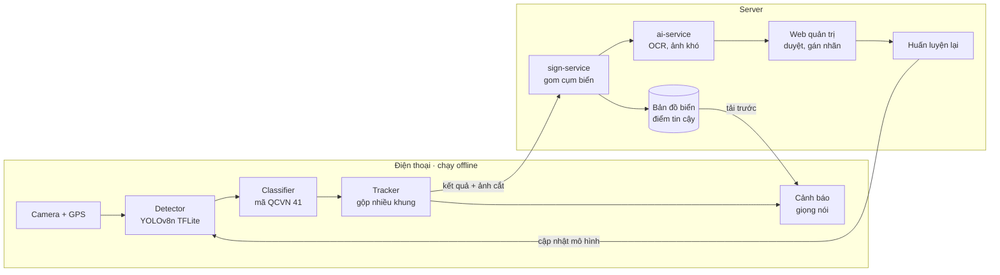

<div align="center">

# Signa

**Trợ lý cảnh báo biển báo giao thông thời gian thực trên thiết bị di động,
sử dụng học sâu và bản đồ cộng đồng tự xác minh**

[](https://github.com/hana200804/DoAn/actions/workflows/docs.yml)
[](LICENSE)

Đồ án tốt nghiệp

</div>

---

## Mục lục

- [Giới thiệu](#giới-thiệu)
- [Tính năng chính](#tính-năng-chính)
- [Kiến trúc tổng quan](#kiến-trúc-tổng-quan)
- [Cấu trúc repository](#cấu-trúc-repository)
- [Tài liệu](#tài-liệu)
- [Quy trình phát triển](#quy-trình-phát-triển)
- [Thành viên](#thành-viên)
- [Giấy phép](#giấy-phép)

## Giới thiệu

Signa biến điện thoại gắn trên ô tô thành một trợ lý hiểu biển báo đường bộ Việt Nam theo QCVN 41:

1. **Nhận diện ngay trên máy** — mô hình học sâu chạy trên điện thoại, không phụ thuộc mạng.
2. **Cảnh báo theo ngữ cảnh** — nhắc bằng giọng nói khi vượt tốc độ hoặc sắp tới biển cấm áp dụng cho xe của mình.
3. **Bản đồ tự xác minh** — kết quả nhận diện từ nhiều xe được gom thành bản đồ biển báo chung; độ tin cậy của mỗi biển tăng theo số xe khác nhau nhìn thấy nó.

## Tính năng chính

| Nhóm | Tính năng | Ưu tiên |
| --- | --- | --- |
| Nhận diện | Phát hiện và phân loại biển theo QCVN 41 trên thiết bị, ≥ 15 FPS | P0 |
| Nhận diện | Theo dõi biển qua nhiều khung hình để giảm báo sai | P0 |
| Cảnh báo | Cảnh báo giọng nói: vượt tốc độ, biển cấm và biển nguy hiểm sắp tới | P0 |
| Bản đồ | Bản đồ biển báo có điểm tin cậy, tải trước theo tuyến | P0 |
| Quản trị | Xử lý ca mâu thuẫn, quản lý danh mục biển | P0 |
| Nhận diện | Đọc biển phụ (khung giờ, loại xe) bằng OCR | P1 |
| Bản đồ | Tìm kiếm địa chỉ, dẫn đường (VietMap API) | P1 |
| MLOps | Gán nhãn ảnh khó, huấn luyện lại, cập nhật mô hình qua mạng | P1 |

Danh sách đầy đủ và tiêu chí chấp nhận: [Đặc tả yêu cầu](docs/02-dac-ta-yeu-cau.md).

## Kiến trúc tổng quan



Chi tiết: [Kiến trúc hệ thống](docs/03-kien-truc.md) · [Thiết kế AI](docs/04-thiet-ke-ai.md).

## Cấu trúc repository

```text
DoAn/
├── docs/        Tài liệu thiết kế: yêu cầu, kiến trúc, AI, dữ liệu, CSDL, API, kiểm thử, hạng mục, ADR
├── mobile/      Ứng dụng Android (Kotlin, Jetpack Compose, CameraX, TFLite)
├── backend/     Microservice Spring Boot: auth-service, map-service, sign-service
├── ai/          Dữ liệu, huấn luyện, đánh giá, xuất mô hình; ai-service (Python, gRPC)
├── web-admin/   Website quản trị và gán nhãn (TypeScript, React)
├── infra/       Docker Compose, cấu hình môi trường, triển khai
└── .github/     Mẫu issue và Pull Request, CI
```

Mỗi thư mục có README riêng mô tả phạm vi, công nghệ, cấu trúc, cách chạy và kiểm thử của phần đó:

| Thành phần | README |
| --- | --- |
| Ứng dụng di động | [mobile/README.md](mobile/README.md) |
| Backend | [backend/README.md](backend/README.md) |
| AI | [ai/README.md](ai/README.md) |
| Web quản trị | [web-admin/README.md](web-admin/README.md) |
| Hạ tầng | [infra/README.md](infra/README.md) |

## Tài liệu

| # | Tài liệu | Nội dung |
| --- | --- | --- |
| 01 | [Tổng quan](docs/01-tong-quan.md) | Mục tiêu, phạm vi, thành phần, các chủ đề chính |
| 02 | [Đặc tả yêu cầu](docs/02-dac-ta-yeu-cau.md) | User story, yêu cầu chức năng và phi chức năng, tiêu chí chấp nhận |
| 03 | [Kiến trúc hệ thống](docs/03-kien-truc.md) | Thành phần, luồng xử lý, triển khai |
| 04 | [Thiết kế AI](docs/04-thiet-ke-ai.md) | Nhận diện, theo dõi, cảnh báo, biển phụ, điểm tin cậy, vòng lặp dữ liệu |
| 05 | [Dữ liệu và gán nhãn](docs/05-du-lieu.md) | Nguồn dữ liệu, danh mục nhãn, hướng dẫn gán nhãn, phiên bản dữ liệu |
| 06 | [Cơ sở dữ liệu](docs/06-co-so-du-lieu.md) | Lược đồ bảng, quan hệ, chỉ mục |
| 07 | [API](docs/07-api.md) | REST, gRPC, định dạng lỗi |
| 08 | [Kiểm thử](docs/08-kiem-thu.md) | Chiến lược kiểm thử, đánh giá mô hình, thử nghiệm thực địa |
| 09 | [Hạng mục công việc](docs/09-hang-muc-cong-viec.md) | Các chủ đề cần hoàn thành, đầu ra, tiêu chí |
| — | [ADR](docs/adr/) | Các quyết định kiến trúc và lý do |

## Quy trình phát triển

```text
feature/* ──PR──► dev ──PR (khi xong một milestone)──► main
```

- **`dev`** — nhánh tích hợp; mọi nhánh tính năng merge vào đây qua Pull Request.
- **`main`** — bản ổn định; chỉ nhận merge từ `dev` khi hoàn thành một milestone, gắn tag phiên bản.

Quy ước nhánh, commit, review: [CONTRIBUTING.md](CONTRIBUTING.md).

## Thành viên

- [@hana200804](https://github.com/hana200804)
- [@Namle1401](https://github.com/Namle1401)
- [@Ahnguyen89](https://github.com/Ahnguyen89)

## Giấy phép

Phát hành theo giấy phép [MIT](LICENSE).
