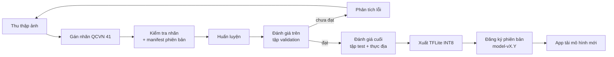

# Signa — AI

Toàn bộ phần học máy: dữ liệu, huấn luyện, đánh giá, xuất mô hình cho điện thoại, và `ai-service` (gRPC) chạy phía server.

> **Trạng thái:** chưa có mã nguồn. Tài liệu này là đặc tả phạm vi và quy ước trước khi code.

## Mục lục

- [Phạm vi](#phạm-vi)
- [Các mô hình](#các-mô-hình)
- [Công nghệ](#công-nghệ)
- [Cấu trúc thư mục dự kiến](#cấu-trúc-thư-mục-dự-kiến)
- [Quy trình huấn luyện](#quy-trình-huấn-luyện)
- [Quản lý dữ liệu và trọng số](#quản-lý-dữ-liệu-và-trọng-số)
- [Ghi nhận thí nghiệm](#ghi-nhận-thí-nghiệm)
- [Chỉ số đánh giá](#chỉ-số-đánh-giá)
- [Cài đặt](#cài-đặt)
- [Tài liệu liên quan](#tài-liệu-liên-quan)

## Phạm vi

| Trong phạm vi | Ngoài phạm vi |
| --- | --- |
| Tập dữ liệu biển báo theo QCVN 41 và tập kiểm thử video thực địa | Mã ứng dụng Android (thuộc [`mobile/`](../mobile/)) |
| Huấn luyện, so sánh YOLOv5 / YOLOv8 / DETR, mô hình hai tầng | Gom cụm và điểm tin cậy (thuộc [`backend/sign-service`](../backend/)) |
| Nén mô hình: INT8, chưng cất, xuất TFLite | |
| Hiệu chỉnh độ tin cậy (temperature scaling) | |
| OCR biển phụ | |
| `ai-service`: gRPC phục vụ OCR và phân loại lại ảnh khó | |

## Các mô hình

| Mô hình | Vai trò | Chạy ở | Đầu vào → đầu ra |
| --- | --- | --- | --- |
| **Detector** (YOLOv8n) | Tìm vùng biển báo, phân theo nhóm hình dạng | Điện thoại | Khung hình 640 px → box + nhóm |
| **Classifier** (MobileNetV3-Small) | Gán mã biển QCVN 41 cho ảnh cắt | Điện thoại | Ảnh cắt 96×96 → mã biển + xác suất |
| **Teacher** (YOLOv8m, 960 px) | Mô hình thầy để chưng cất; phân loại lại ảnh khó | Server | Ảnh → box + mã biển |
| **OCR** (PaddleOCR / VietOCR) | Đọc chữ biển phụ | Server | Ảnh cắt biển phụ → chuỗi + điều kiện |
| **Baseline** YOLOv5s, YOLOv8s, DETR-R50 | Mô hình đối chứng để so sánh | Máy huấn luyện | — |

Thiết kế chi tiết: [Thiết kế AI](../docs/04-thiet-ke-ai.md) · Lý do tách hai tầng: [ADR-0003](../docs/adr/0003-mo-hinh-hai-tang.md).

## Công nghệ

| Hạng mục | Lựa chọn |
| --- | --- |
| Ngôn ngữ | Python 3.11 |
| Học sâu | PyTorch, Ultralytics, timm, Hugging Face Transformers (DETR) |
| Tăng cường dữ liệu | Albumentations |
| Gán nhãn | Roboflow (khởi đầu) → hàng đợi gán nhãn trên web quản trị |
| Xuất mô hình | Ultralytics export → TFLite INT8; ONNX cho server |
| Theo dõi thí nghiệm | File YAML + CSV trong `experiments/` (đủ cho quy mô đồ án) |
| Phiên bản dữ liệu | Manifest có hash trong `data/manifests/`, ảnh lưu ở MinIO / Google Drive |
| Phục vụ | gRPC (`grpcio`), ONNX Runtime |
| Chất lượng mã | Ruff, mypy, pytest |

## Cấu trúc thư mục dự kiến

```text
ai/
├── configs/                 # cấu hình huấn luyện YAML (một file cho mỗi thí nghiệm)
│   ├── data/                # định nghĩa tập dữ liệu, danh sách nhãn
│   └── train/
├── data/
│   ├── manifests/           # danh sách file + hash theo phiên bản (có trong git)
│   ├── labels.yaml          # danh mục nhãn QCVN 41 (có trong git)
│   └── raw/ processed/      # ảnh (KHÔNG commit)
├── src/signa_ai/
│   ├── data/                # tải, kiểm tra, chia tập, tăng cường
│   ├── train/               # huấn luyện detector, classifier, chưng cất
│   ├── eval/                # mAP, recall theo lớp, ECE, đánh giá trên video
│   ├── export/              # TFLite INT8, ONNX
│   └── serving/             # ai-service gRPC
├── experiments/             # kết quả từng thí nghiệm (EXP-xxx.md + metrics.csv)
├── notebooks/               # khám phá dữ liệu, phân tích lỗi (không chứa logic chính)
├── tests/
├── weights/                 # trọng số (KHÔNG commit, xem bên dưới)
├── pyproject.toml
└── Dockerfile               # ảnh cho ai-service
```

## Quy trình huấn luyện



Một mô hình chỉ được phát hành khi **không kém hơn** mô hình hiện hành trên cả tập test và tập video thực địa. Hai tập này chỉ dùng để báo cáo sau khi đã chốt mô hình; mọi lựa chọn tham số, ngưỡng và hiệu chỉnh độ tin cậy dùng tập validation.

## Quản lý dữ liệu và trọng số

- **Không commit** ảnh và trọng số vào git (đã chặn trong `.gitignore`).
- Mỗi phiên bản dữ liệu có một manifest `data/manifests/vX.Y.csv` (đường dẫn, hash SHA-256, split, nhãn) — manifest có trong git.
- Trọng số phát hành được tải lên MinIO (bucket `models`) và đăng ký trong bảng `model_versions`; app tải qua API mô hình. Bản lưu trữ đính kèm GitHub Release với tag `model-vX.Y`.
- Quy tắc gán nhãn và phân chia tập: [Kế hoạch dữ liệu](../docs/05-du-lieu.md).

## Ghi nhận thí nghiệm

Mỗi thí nghiệm có issue loại **Thí nghiệm AI**, nhánh `exp/<mô-tả>` và một file `experiments/EXP-<số>.md`:

```markdown
# EXP-007: YOLOv8n 960 px + lớp P2
- Giả thuyết: ảnh đầu vào lớn hơn tăng AP_small ≥ 5 điểm
- Dữ liệu: v1.2 · Cấu hình: configs/train/exp007.yaml · Commit: abc1234
- Kết quả: mAP@0.5 = … · AP_small = … · FPS (Pixel 6a) = …
- Kết luận: giữ / bỏ, vì …
```

## Chỉ số đánh giá

| Chỉ số | Mục tiêu | Ghi chú |
| --- | --- | --- |
| mAP@0.5 | ≥ 0,89 | Trên tập test |
| mAP@0.5:0.95 | ≥ 0,75 | |
| Recall nhóm biển cấm + tốc độ | ≥ 0,90 | Bỏ lỡ biển cấm nguy hiểm hơn báo nhầm |
| Độ giảm mAP sau INT8 | < 2 điểm | So với FP32 |
| ECE sau hiệu chỉnh | < 0,05 | |
| Cảnh báo sai / 10 km | Giảm so với nhận diện từng khung | Đo trên video thực địa |

## Cài đặt

> Hướng dẫn chi tiết được bổ sung khi khởi tạo mã nguồn.

```bash
cd ai
python -m venv .venv
source .venv/bin/activate          # Windows: .venv\Scripts\activate
pip install -e ".[dev]"
pytest
```

Huấn luyện cần GPU NVIDIA ≥ 8 GB VRAM.

## Tài liệu liên quan

- [Thiết kế AI](../docs/04-thiet-ke-ai.md)
- [Kế hoạch dữ liệu và hướng dẫn gán nhãn](../docs/05-du-lieu.md)
- [Kế hoạch kiểm thử](../docs/08-kiem-thu.md)
