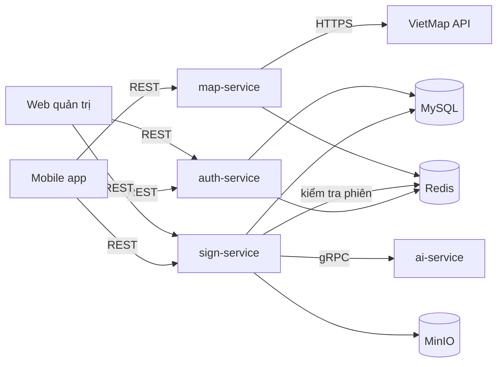

# Signa — Backend

Các microservice nghiệp vụ viết bằng Java Spring Boot: xác thực, bản đồ, biển báo thời gian thực (gom cụm quan sát và tính điểm tin cậy).

> **Trạng thái:** chưa có mã nguồn. Tài liệu này là đặc tả phạm vi và quy ước trước khi code.

## Mục lục

- [Danh sách service](#danh-sách-service)
- [Công nghệ](#công-nghệ)
- [Sơ đồ giao tiếp](#sơ-đồ-giao-tiếp)
- [Cấu trúc thư mục dự kiến](#cấu-trúc-thư-mục-dự-kiến)
- [Quy ước trong mỗi service](#quy-ước-trong-mỗi-service)
- [Cài đặt và chạy](#cài-đặt-và-chạy)
- [Biến môi trường](#biến-môi-trường)
- [Kiểm thử](#kiểm-thử)
- [Tài liệu liên quan](#tài-liệu-liên-quan)

## Danh sách service

| Service | Cổng | Trách nhiệm | Lưu trữ |
| --- | --- | --- | --- |
| `auth-service` | 8081 | Đăng ký, đăng nhập, phân quyền, quên mật khẩu (OTP qua email), quản lý phiên | MySQL `auth_db`, Redis |
| `map-service` | 8082 | Tìm kiếm địa chỉ, chỉ đường, geocoding — gọi VietMap API | Redis (cache) |
| `sign-service` | 8083 | Nhận quan sát biển báo, gom cụm, điểm tin cậy, báo cáo sai, đánh giá, thống kê, hàng đợi gán nhãn | MySQL `sign_db`, MinIO |
| `ai-service` | 9090 (gRPC) | OCR biển phụ, phân loại lại ảnh khó bằng mô hình lớn — nằm trong [`ai/`](../ai/) | — |

`sign-service` là trung tâm nghiệp vụ; lý do tách service và dùng gRPC: [ADR-0005](../docs/adr/0005-microservices-grpc.md).

## Công nghệ

| Hạng mục | Lựa chọn |
| --- | --- |
| Ngôn ngữ / framework | Java 21, Spring Boot 3.x |
| Build | Gradle (Kotlin DSL), multi-project |
| Web | Spring Web (REST), springdoc-openapi (Swagger UI) |
| Bảo mật | Spring Security, BCrypt |
| Dữ liệu | Spring Data JPA, MySQL 8, Flyway (migration) |
| Cache / phiên | Redis |
| Lưu ảnh | MinIO (S3 API) |
| Giao tiếp nội bộ | gRPC (`grpc-spring-boot-starter`), Protobuf trong `backend/proto/` |
| Bất đồng bộ | Hàng đợi Redis Streams cho xử lý ảnh, geocoding |
| Quan sát | Spring Boot Actuator, log JSON |

## Sơ đồ giao tiếp



Mỗi service tự xác thực request bằng session ID tra trong Redis (không có API Gateway trong phạm vi đồ án).

## Cấu trúc thư mục dự kiến

```text
backend/
├── proto/                       # file .proto dùng chung (sign-service ↔ ai-service)
├── common/                      # thư viện chung: DTO lỗi, xác thực phiên, tiện ích
├── auth-service/
├── map-service/
├── sign-service/
│   └── src/main/java/com/signa/sign/
│       ├── api/                 # controller, DTO request/response
│       ├── application/         # service nghiệp vụ, use case
│       ├── domain/              # entity, logic gom cụm + điểm tin cậy
│       ├── infrastructure/      # JPA repository, MinIO, gRPC client, Redis Streams
│       └── config/
├── build.gradle.kts
└── settings.gradle.kts
```

## Quy ước trong mỗi service

- Phân lớp `api → application → domain ← infrastructure`; `domain` không phụ thuộc Spring.
- Mọi thay đổi lược đồ qua migration Flyway `V<n>__<mo_ta>.sql`; không sửa migration đã merge.
- Lỗi trả về theo một định dạng chung (xem [API](../docs/07-api.md#2-định-dạng-lỗi)).
- Endpoint mới phải có trong OpenAPI và test tích hợp.
- Khoá ngoài giữa các service chỉ là ID, không join chéo CSDL.

## Cài đặt và chạy

> Hướng dẫn chi tiết được bổ sung khi khởi tạo mã nguồn.

Yêu cầu: JDK 21, Docker.

```bash
# Chạy từ thư mục gốc của repo
# Hạ tầng (MySQL, Redis, MinIO)
docker compose -f infra/docker-compose.yml up -d mysql redis minio

# Chạy một service
cd backend
cp sign-service/.env.example sign-service/.env
./gradlew :sign-service:bootRun
```

Mỗi service nạp file `.env` của mình qua `spring.config.import=optional:file:.env[.properties]` trong `application.yml`; biến môi trường thật luôn được ưu tiên.

Swagger UI: `http://localhost:8083/swagger-ui.html`.

## Biến môi trường

| Biến | Service | Ý nghĩa |
| --- | --- | --- |
| `DB_URL`, `DB_USER`, `DB_PASSWORD` | auth, sign | Kết nối MySQL |
| `REDIS_HOST`, `REDIS_PORT` | tất cả | Redis |
| `MINIO_ENDPOINT`, `MINIO_ACCESS_KEY`, `MINIO_SECRET_KEY` | sign | MinIO |
| `AI_SERVICE_ADDR` | sign | Địa chỉ gRPC ai-service, ví dụ `ai-service:9090` |
| `VIETMAP_API_KEY` | map | Khoá VietMap |
| `MAIL_USERNAME`, `MAIL_PASSWORD` | auth | SMTP gửi OTP |

## Kiểm thử

| Loại | Công cụ | Lệnh |
| --- | --- | --- |
| Unit (domain: gom cụm, điểm tin cậy) | JUnit 5, AssertJ | `./gradlew test` |
| Tích hợp (JPA, Redis, MinIO) | Testcontainers | `./gradlew integrationTest` |
| Hợp đồng gRPC | Test với stub ai-service | `./gradlew :sign-service:test` |

## Tài liệu liên quan

- [Kiến trúc hệ thống](../docs/03-kien-truc.md)
- [Thiết kế cơ sở dữ liệu](../docs/06-co-so-du-lieu.md)
- [Đặc tả API](../docs/07-api.md)
- [ADR-0004: Điểm tin cậy thay cho luật 20 m](../docs/adr/0004-diem-tin-cay-ban-do.md)
