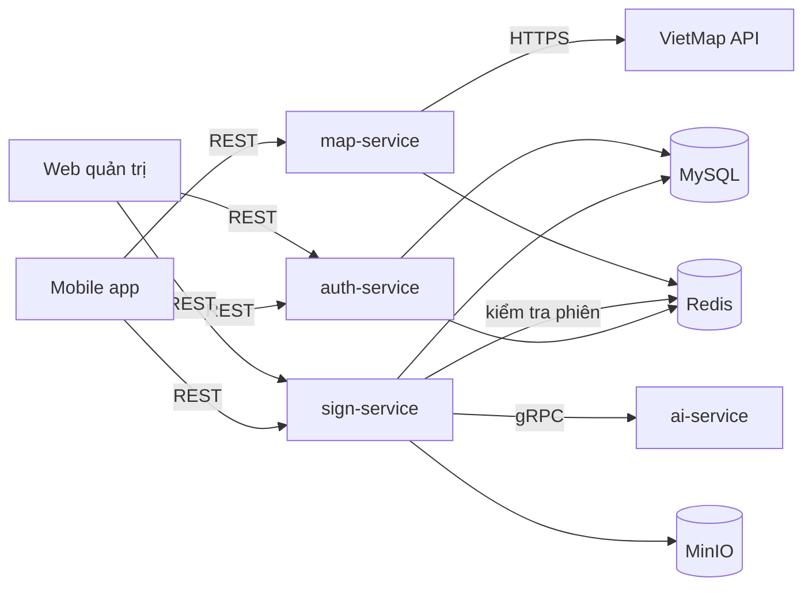

# Signa — Backend

Các microservice nghiệp vụ viết bằng Java Spring Boot: xác thực, bản đồ, biển báo thời gian thực (gom cụm quan sát và tính điểm tin cậy).

## Mục lục

- [Danh sách service](#danh-sách-service)
- [Công nghệ](#công-nghệ)
- [Sơ đồ giao tiếp](#sơ-đồ-giao-tiếp)
- [Cấu trúc thư mục dự kiến](#cấu-trúc-thư-mục-dự-kiến)
- [Quy ước trong mỗi service](#quy-ước-trong-mỗi-service)
- [Cài đặt và chạy](#cài-đặt-và-chạy)
- [Biến môi trường](#biến-môi-trường)
- [Kiểm thử](#kiểm-thử)
- [Tài liệu liên quan](#tài-liệu-liên-quan)

## Danh sách service

| Service | Cổng | Trách nhiệm | Lưu trữ |
| --- | --- | --- | --- |
| `auth-service` | 8081 | Đăng ký, đăng nhập, phân quyền, quên mật khẩu (OTP qua email), quản lý phiên | MySQL `auth_db`, Redis |
| `map-service` | 8082 | Tìm kiếm địa chỉ, chỉ đường, geocoding — gọi VietMap API | Redis (cache) |
| `sign-service` | 8083 | Nhận quan sát biển báo, gom cụm, điểm tin cậy, báo cáo sai, đánh giá, thống kê, hàng đợi gán nhãn | MySQL `sign_db`, MinIO |
| `ai-service` | 9090 (gRPC) | OCR biển phụ, phân loại lại ảnh khó bằng mô hình lớn — nằm trong [`ai/`](../ai/) | — |

`sign-service` là trung tâm nghiệp vụ; lý do tách service và dùng gRPC: [ADR-0005](../docs/adr/0005-microservices-grpc.md).

## Công nghệ

| Hạng mục | Lựa chọn |
| --- | --- |
| Ngôn ngữ / framework | Java 21, Spring Boot 3.x |
| Build | Gradle (Kotlin DSL), multi-project |
| Web | Spring Web (REST), springdoc-openapi (Swagger UI) |
| Bảo mật | Spring Security, BCrypt |
| Dữ liệu | MySQL 8, Flyway; Spring Data JPA (auth-service), JdbcTemplate (sign-service) |
| Cache / phiên | Redis |
| Lưu ảnh | Kho S3 (RustFS khi chạy bằng `infra/`), client MinIO Java |
| Giao tiếp nội bộ | gRPC tới ai-service, Protobuf trong `backend/proto/` (chưa cài, #42) |
| Xử lý quan sát | Đồng bộ trong request `complete`; chuyển sang Redis Stream khi tải vượt NFR-12 |
| Quan sát | Spring Boot Actuator, log JSON |

## Sơ đồ giao tiếp



Mỗi service tự xác thực request bằng session ID tra trong Redis (không có API Gateway trong phạm vi đồ án).

## Cấu trúc thư mục dự kiến

```text
backend/
├── common/            # lỗi chung, X-Request-Id, phiên Redis, @Authenticated, rate limit
├── auth-service/      # tài khoản, phiên, OTP (JPA)
├── map-service/       # proxy VietMap có cache Redis
├── sign-service/
│   └── src/main/java/com/signa/sign/
│       ├── api/       # controller, DTO
│       ├── app/       # ObservationService (gom cụm), ReviewService (mâu thuẫn, báo cáo)
│       ├── domain/    # ClusterRules (điểm tin cậy Beta), Geo — Java thuần, có test
│       └── store/     # SignRepository (JdbcTemplate), CropStorage (S3)
├── Dockerfile         # dùng chung: --build-arg SERVICE=<tên service>
├── build.gradle.kts
└── settings.gradle.kts
```

## Quy ước trong mỗi service

- Phân lớp `api → application → domain ← infrastructure`; `domain` không phụ thuộc Spring.
- Mọi thay đổi lược đồ qua migration Flyway `V<n>__<mo_ta>.sql`; không sửa migration đã merge.
- Lỗi trả về theo một định dạng chung (xem [API](../docs/07-api.md#2-định-dạng-lỗi)).
- Endpoint mới phải có trong OpenAPI và test tích hợp.
- Khoá ngoài giữa các service chỉ là ID, không join chéo CSDL.

## Cài đặt và chạy

Yêu cầu: Docker (để build và chạy), JDK 21 (để chạy test ngoài Docker).

Cả ba service chạy cùng hạ tầng bằng Docker Compose; điểm vào duy nhất là nginx ở cổng 8080:

```bash
cd infra
cp .env.example .env    # đổi mật khẩu, điền ADMIN_*, VIETMAP_API_KEY, MINIO_PUBLIC_ENDPOINT
docker compose up -d --build
curl http://localhost:8080/api/v1/signs?bbox=105.8,21.0,105.9,21.1
```

Biến môi trường lấy từ `infra/.env`; giá trị mặc định cho từng service nằm trong `application.yml` của service đó. Để trống `MAIL_HOST` thì OTP được ghi ra log của auth-service thay vì gửi email.

Swagger UI có trong từng service (`/swagger-ui.html`) nhưng nginx không công bố ra ngoài; xem bằng `docker compose exec` hoặc mở cổng service khi phát triển.

## Biến môi trường

| Biến | Service | Ý nghĩa |
| --- | --- | --- |
| `DB_URL`, `DB_USER`, `DB_PASSWORD` | auth, sign | Kết nối MySQL |
| `REDIS_HOST`, `REDIS_PORT` | tất cả | Redis |
| `ADMIN_EMAIL`, `ADMIN_PASSWORD` | auth | Tài khoản quản trị tạo lúc khởi động (mật khẩu ≥ 12 ký tự) |
| `MINIO_ENDPOINT`, `MINIO_PUBLIC_ENDPOINT`, `MINIO_ACCESS_KEY`, `MINIO_SECRET_KEY`, `MINIO_BUCKET` | sign | Kho ảnh S3 (RustFS/MinIO); địa chỉ công khai dùng để ký presigned URL |
| `VIETMAP_API_KEY`, `VIETMAP_BASE_URL` | map | VietMap |
| `MAIL_HOST`, `MAIL_PORT`, `MAIL_USERNAME`, `MAIL_PASSWORD` | auth | SMTP gửi OTP (Compose chuyển thành `SPRING_MAIL_*`); host trống thì chỉ ghi log |

## Kiểm thử

| Loại | Công cụ | Lệnh |
| --- | --- | --- |
| Unit (domain: gom cụm, điểm tin cậy) | JUnit 5, AssertJ | `./gradlew test` |
| Tích hợp (MySQL, Redis thật) | Testcontainers, cần Docker | `./gradlew test -Pintegration` |
| Định dạng mã | Spotless, google-java-format | `./gradlew spotlessCheck` (sửa: `spotlessApply`) |

## Tài liệu liên quan

- [Kiến trúc hệ thống](../docs/03-kien-truc.md)
- [Thiết kế cơ sở dữ liệu](../docs/06-co-so-du-lieu.md)
- [Đặc tả API](../docs/07-api.md)
- [ADR-0004: Điểm tin cậy thay cho luật 20 m](../docs/adr/0004-diem-tin-cay-ban-do.md)
