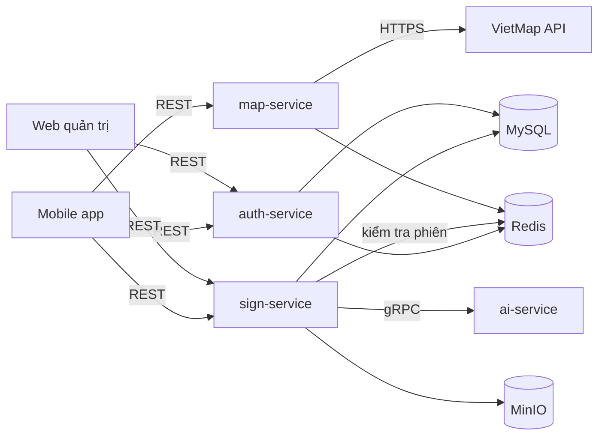

# Signa — Backend

Các microservice nghiệp vụ viết bằng Java Spring Boot: xác thực, bản đồ, biển báo thời gian thực (gom cụm quan sát và tính điểm tin cậy).

## Mục lục

- [Danh sách service](#danh-sách-service)
- [Công nghệ](#công-nghệ)
- [Sơ đồ giao tiếp](#sơ-đồ-giao-tiếp)
- [Cấu trúc thư mục dự kiến](#cấu-trúc-thư-mục-dự-kiến)
- [Quy ước trong mỗi service](#quy-ước-trong-mỗi-service)
- [Cài đặt và chạy](#cài-đặt-và-chạy)
- [Biến môi trường](#biến-môi-trường)
- [Kiểm thử](#kiểm-thử)
- [Tài liệu liên quan](#tài-liệu-liên-quan)

## Danh sách service

| Service | Cổng | Trách nhiệm | Lưu trữ |
| --- | --- | --- | --- |
| `auth-service` | 8081 | Đăng ký, đăng nhập, phân quyền, quên mật khẩu (OTP qua email), quản lý phiên | MySQL `auth_db`, Redis |
| `map-service` | 8082 | Tìm kiếm địa chỉ, chỉ đường, geocoding — gọi VietMap API | Redis (cache) |
| `sign-service` | 8083 | Nhận quan sát biển báo, gom cụm, điểm tin cậy, báo cáo sai, đánh giá, thống kê, hàng đợi gán nhãn | MySQL `sign_db`, MinIO |
| `ai-service` | 9090 (gRPC) | OCR biển phụ, phân loại lại ảnh khó bằng mô hình lớn — nằm trong [`ai/`](../ai/) | — |

`sign-service` là trung tâm nghiệp vụ; lý do tách service và dùng gRPC: [ADR-0005](../docs/adr/0005-microservices-grpc.md).

## Công nghệ

| Hạng mục | Lựa chọn |
| --- | --- |
| Ngôn ngữ / framework | Java 21, Spring Boot 3.x |
| Build | Gradle (Kotlin DSL), multi-project |
| Web | Spring Web (REST), springdoc-openapi (Swagger UI) |
| Bảo mật | Spring Security, BCrypt |
| Dữ liệu | MySQL 8, Flyway; Spring Data JPA (auth-service), JdbcTemplate (sign-service) |
| Cache / phiên | Redis |
| Lưu ảnh | Kho S3 (RustFS khi chạy bằng `infra/`), client MinIO Java |
| Giao tiếp nội bộ | gRPC tới ai-service, Protobuf trong `backend/proto/`, sinh Java qua module `ai-client` |
| Xử lý quan sát | Đồng bộ trong request `complete`; chuyển sang Redis Stream khi tải vượt NFR-12 |
| Quan sát | Spring Boot Actuator, log JSON |

## Sơ đồ giao tiếp



Mỗi service tự xác thực request bằng session ID tra trong Redis (không có API Gateway trong phạm vi đồ án).

## Cấu trúc thư mục dự kiến

```text
backend/
├── common/            # lỗi chung, X-Request-Id, phiên Redis, @Authenticated, rate limit
├── auth-service/      # tài khoản, phiên, OTP (JPA)
├── map-service/       # proxy VietMap có cache Redis
├── sign-service/
│   └── src/main/java/com/signa/sign/
│       ├── api/       # controller, DTO
│       ├── app/       # Quan sát, duyệt, gán nhãn và phát hành mô hình
│       ├── ai/        # Client gRPC, worker hàng đợi có lease và retry
│       ├── domain/    # ClusterRules (điểm tin cậy Beta), Geo — Java thuần, có test
│       └── store/     # SignRepository (JdbcTemplate), CropStorage (S3)
├── Dockerfile         # dùng chung: --build-arg SERVICE=<tên service>
├── build.gradle.kts
└── settings.gradle.kts
```

## Quy ước trong mỗi service

- Phân lớp `api → application → domain ← infrastructure`; `domain` không phụ thuộc Spring.
- Mọi thay đổi lược đồ qua migration Flyway `V<n>__<mo_ta>.sql`; không sửa migration đã merge.
- Lỗi trả về theo một định dạng chung (xem [API](../docs/07-api.md#2-định-dạng-lỗi)).
- Endpoint mới phải có trong OpenAPI và test tích hợp.
- Khoá ngoài giữa các service chỉ là ID, không join chéo CSDL.

## Cài đặt và chạy

Yêu cầu: Docker (để build và chạy), JDK 21 (để chạy test ngoài Docker).

Cả ba service chạy cùng hạ tầng bằng Docker Compose; điểm vào duy nhất là nginx ở cổng 8080:

```bash
cd infra
cp .env.example .env    # đổi mật khẩu, điền ADMIN_*, VIETMAP_API_KEY, MINIO_PUBLIC_ENDPOINT
docker compose up -d --build
curl http://localhost:8080/api/v1/signs?bbox=105.8,21.0,105.9,21.1
```

Biến môi trường lấy từ `infra/.env`; giá trị mặc định cho từng service nằm trong `application.yml` của service đó. Để trống `MAIL_HOST` thì OTP được ghi ra log của auth-service thay vì gửi email.

Swagger UI có trong từng service (`/swagger-ui.html`) nhưng nginx không công bố ra ngoài; xem bằng `docker compose exec` hoặc mở cổng service khi phát triển.

## Biến môi trường

| Biến | Service | Ý nghĩa |
| --- | --- | --- |
| `DB_URL`, `DB_USER`, `DB_PASSWORD` | auth, sign | Kết nối MySQL |
| `REDIS_HOST`, `REDIS_PORT` | tất cả | Redis |
| `ADMIN_EMAIL`, `ADMIN_PASSWORD` | auth | Tài khoản quản trị tạo lúc khởi động (mật khẩu ≥ 12 ký tự) |
| `MINIO_ENDPOINT`, `MINIO_PUBLIC_ENDPOINT`, `MINIO_ACCESS_KEY`, `MINIO_SECRET_KEY`, `MINIO_BUCKET` | sign | Kho ảnh S3 (RustFS/MinIO); địa chỉ công khai dùng để ký presigned URL |
| `VIETMAP_API_KEY`, `VIETMAP_BASE_URL` | map | VietMap |
| `MAIL_HOST`, `MAIL_PORT`, `MAIL_USERNAME`, `MAIL_PASSWORD` | auth | SMTP gửi OTP (Compose chuyển thành `SPRING_MAIL_*`); host trống thì chỉ ghi log |
| `AI_ENABLED`, `AI_TARGET`, `AI_TIMEOUT` | sign | Bật worker AI (mặc định `false`); đích gRPC (mặc định `localhost:9090`); hạn chót mỗi RPC (mặc định `PT3S`) |
| `MINIO_MODEL_BUCKET` | sign | Bucket chứa artifact mô hình, mặc định `models` |
| `LABEL_DATASET_VERSION` | sign | Phiên bản dữ liệu đích mặc định khi duyệt nhãn, mặc định `v1.0` |

## Kiểm thử

| Loại | Công cụ | Lệnh |
| --- | --- | --- |
| Unit (domain: gom cụm, điểm tin cậy) | JUnit 5, AssertJ | `./gradlew test` |
| Tích hợp (MySQL, Redis thật) | Testcontainers, cần Docker | `./gradlew test -Pintegration` |
| Định dạng mã | Spotless, google-java-format | `./gradlew spotlessCheck` (sửa: `spotlessApply`) |

Riêng test tích hợp sign-service có thể dùng một CSDL MySQL 8 **riêng cho kiểm thử** khi không có Docker:

```bash
SIGNA_TEST_DB_URL='jdbc:mysql://localhost:3306/signa_test' \
SIGNA_TEST_DB_USER=root SIGNA_TEST_DB_PASSWORD=your-test-password \
./gradlew :sign-service:test -Pintegration --no-daemon
```

Flyway tạo lược đồ và test ghi dữ liệu vào CSDL này. Khi không đặt `SIGNA_TEST_DB_URL`, test tự chạy MySQL bằng Testcontainers.

## Xử lý AI và phát hành mô hình

Phần back-end cung cấp client Java và hợp đồng gRPC; dịch vụ inference Python và trọng số được bàn giao riêng. Worker mặc định tắt (`AI_ENABLED=false`). Khi bật worker, cần đặt `AI_TARGET` tới dịch vụ triển khai đúng hợp đồng trong `backend/proto/`. Các job đã lưu chờ worker xử lý.

- `complete` gom cụm trong transaction; một khoá MySQL ngăn hai lô đồng thời tạo hai cụm cho cùng biển. Kiểm tra S3 diễn ra trước khoá này.
- Ảnh có `LOW_CONF`, `SPLIT_VOTE`, `MISMATCH` tạo tác vụ gán nhãn; ảnh có biển phụ và ảnh khó tạo job trong `observation_analysis`.
- Worker gọi AI ngoài transaction, giữ lease 60 giây, retry tối đa 5 lần với thời gian chờ tăng dần. Kết quả phân loại lại là gợi ý duyệt, không tự thay quyết định của quản trị viên.
- OCR đủ tin cậy (≥ 0,8) cập nhật theo thời điểm quan sát, không giữ lịch cũ chỉ vì confidence cao hơn. Kết quả từ ảnh cũ đến muộn, quan sát không có trọng số hoặc khác mã cụm không được áp dụng. Điều kiện đã duyệt tay được bảo vệ khỏi AI ghi đè.
- Tác vụ trả cả ảnh biển chính và ảnh biển phụ. API `/admin/label-tasks/{id}/ocr` lưu chữ và điều kiện đã duyệt; tác vụ ảnh khó yêu cầu chốt thêm nhãn biển chính.
- API quản trị gán nhãn, đăng ký/kích hoạt/quay lui mô hình và thống kê đã có trong [đặc tả API](../docs/07-api.md). Đăng ký và kích hoạt đều kiểm tra SHA-256 và kích thước file thật trong S3.
- File phát hành đặt trong bucket riêng `MINIO_MODEL_BUCKET` (mặc định `models`); file ONNX phục vụ server gắn riêng vào container AI. Repository chưa có trọng số huấn luyện hay số liệu chất lượng thực địa.

## Tài liệu liên quan

- [Kiến trúc hệ thống](../docs/03-kien-truc.md)
- [Thiết kế cơ sở dữ liệu](../docs/06-co-so-du-lieu.md)
- [Đặc tả API](../docs/07-api.md)
- [ADR-0004: Điểm tin cậy thay cho luật 20 m](../docs/adr/0004-diem-tin-cay-ban-do.md)

## Đối chiếu yêu cầu back-end

Xem [phạm vi, đối chiếu yêu cầu và nhật ký bàn giao back-end](IMPLEMENTATION.md). `LABEL_DATASET_VERSION` đặt phiên bản dữ liệu đích mặc định cho nhãn; request có thể chỉ định `datasetVersion`. Tác vụ có biển phụ giữ OPEN sau khi gán nhãn chính cho đến khi duyệt OCR hoặc bỏ qua. Export dataset trả ảnh, nhãn và SHA-256 qua API quản trị.

Model có trạng thái DRAFT/ACTIVE/RETIRED, thẻ số liệu bắt buộc khi đăng ký. Kích hoạt kiểm tra ngưỡng thiết kế và so với bản đang dùng; bản RETIRED có thể quay lui. Các model cũ thiếu thẻ sau migration V5 trở lại DRAFT; bổ sung thẻ thật qua API rồi mới kích hoạt lại.

Test Redis có thể chạy trên một instance **riêng cho kiểm thử** khi không có Docker: đặt `SIGNA_TEST_REDIS_HOST=127.0.0.1` và `SIGNA_TEST_REDIS_PORT=<cổng test>` rồi chạy `./gradlew test -Pintegration` cùng cấu hình MySQL ở trên. CI không đặt các biến này nên vẫn dùng Testcontainers Redis 7.4. Không trỏ test vào Redis đang dùng cho tài khoản thật.
