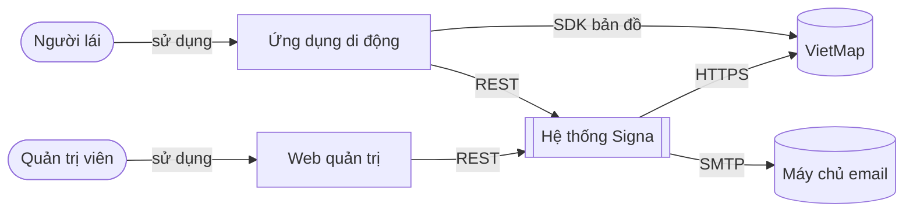
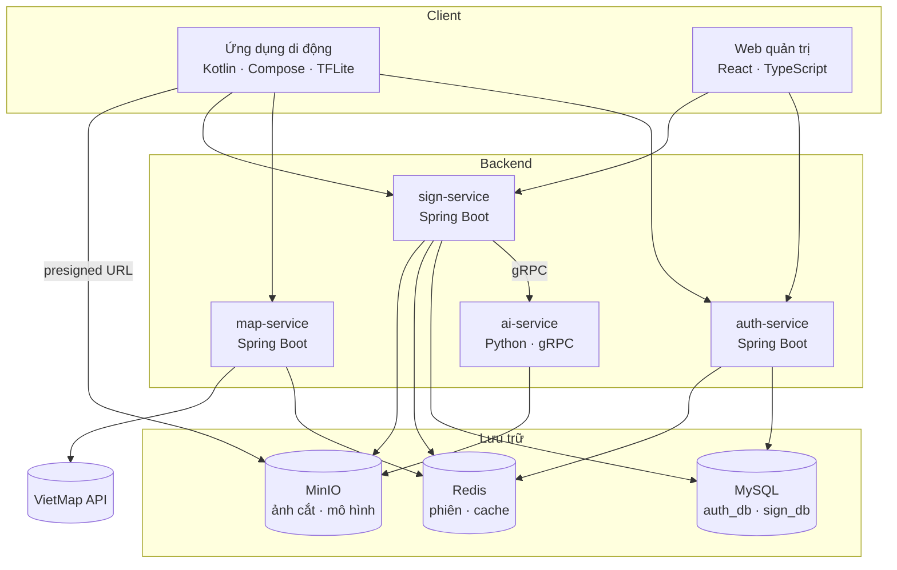
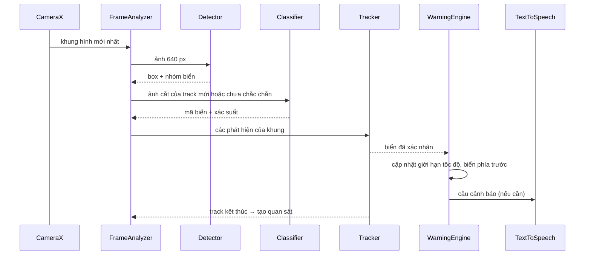
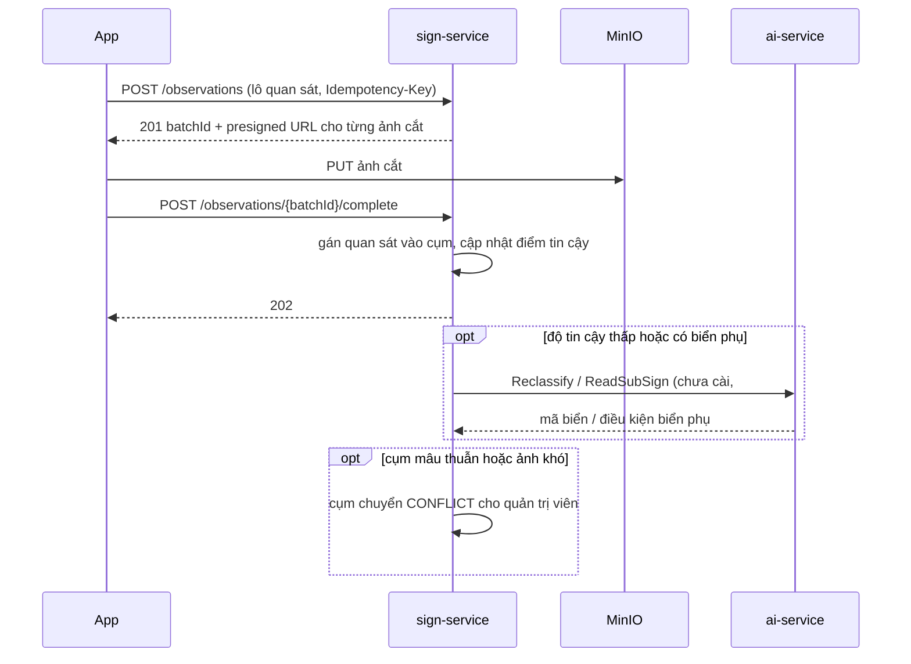
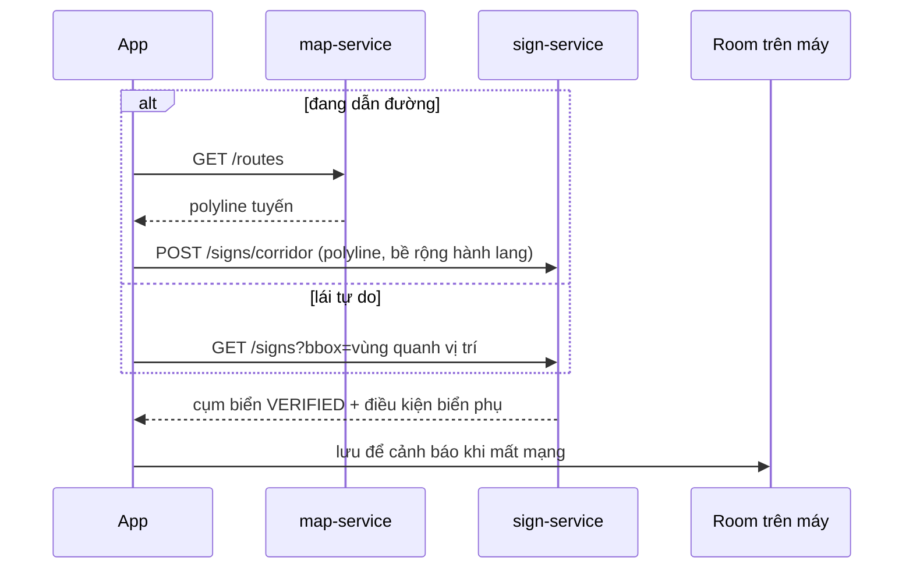
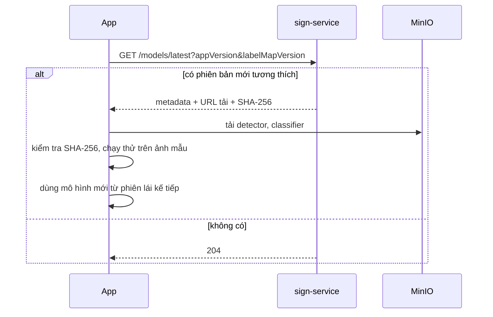
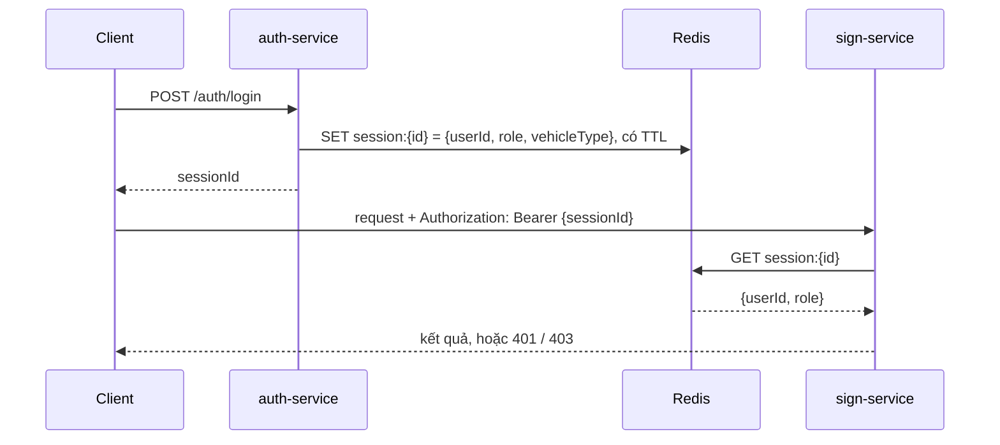
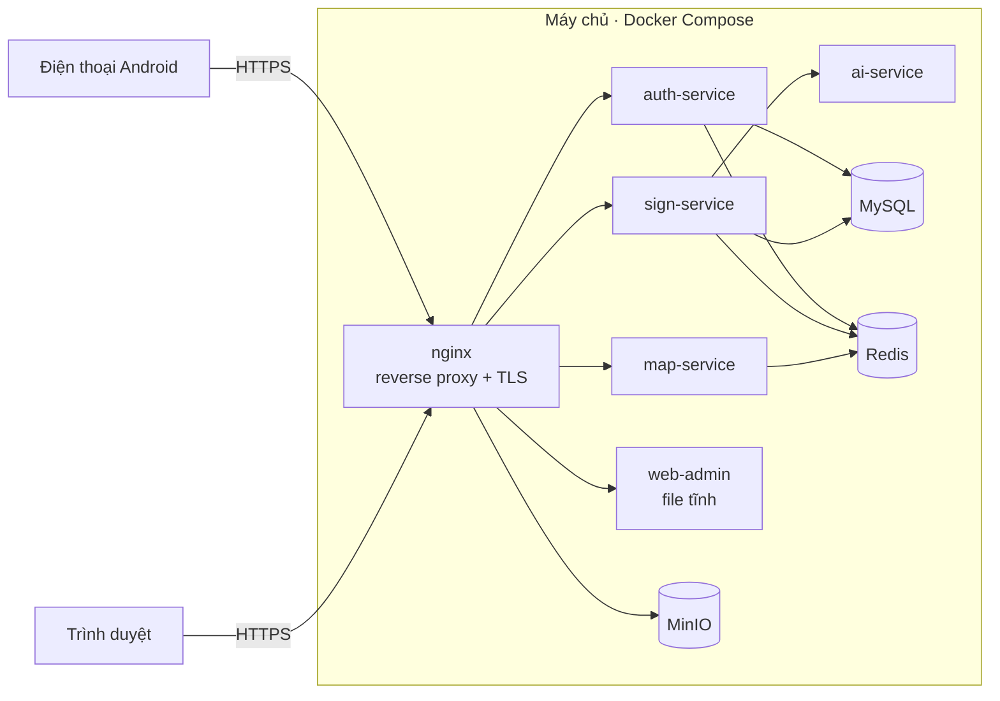

# 03 · Kiến trúc hệ thống

## Mục lục

1. [Nguyên tắc](#1-nguyên-tắc)
2. [Sơ đồ ngữ cảnh](#2-sơ-đồ-ngữ-cảnh)
3. [Sơ đồ thành phần](#3-sơ-đồ-thành-phần)
4. [Trách nhiệm từng thành phần](#4-trách-nhiệm-từng-thành-phần)
5. [Luồng xử lý chính](#5-luồng-xử-lý-chính)
6. [Triển khai](#6-triển-khai)
7. [Vấn đề xuyên suốt](#7-vấn-đề-xuyên-suốt)
8. [Quyết định liên quan](#8-quyết-định-liên-quan)

## 1. Nguyên tắc

| Nguyên tắc | Hệ quả thiết kế |
| --- | --- |
| **Offline trước** — chức năng an toàn không phụ thuộc mạng | Nhận diện, theo dõi, cảnh báo chạy trên điện thoại; server chỉ bổ sung dữ liệu |
| **Gửi ít, gửi đúng** | App gửi quan sát đã gộp và ảnh cắt vùng biển, không gửi khung hình |
| **Tách AI khỏi nghiệp vụ** | Mô hình nặng chạy ở ai-service (Python); nghiệp vụ ở các service Java |
| **Mô hình có phiên bản** | Mỗi quan sát ghi phiên bản mô hình và label map; mô hình phát hành có kiểm tra SHA-256 |
| **Mỗi dữ liệu thuộc về một service** | Mỗi CSDL chỉ do một service ghi; service khác truy cập qua API |

## 2. Sơ đồ ngữ cảnh

## 3. Sơ đồ thành phần

## 4. Trách nhiệm từng thành phần

| Thành phần | Trách nhiệm | Dữ liệu sở hữu | Không làm |
| --- | --- | --- | --- |
| Ứng dụng di động | Nhận diện, theo dõi, cảnh báo, bản đồ, hàng đợi quan sát, cập nhật mô hình | Room: biển tải trước, hàng đợi gửi, cài đặt | Gom cụm, tính điểm tin cậy |
| auth-service | Đăng ký, đăng nhập, phiên, phân quyền, OTP quên mật khẩu | `auth_db`, khoá `session:*`, `otp:*` trong Redis | Nghiệp vụ biển báo |
| map-service | Tìm kiếm địa chỉ, geocoding ngược, chỉ đường; cache kết quả VietMap | Cache Redis | Lưu dữ liệu lâu dài |
| sign-service | Tiếp nhận quan sát, gom cụm, điểm tin cậy, báo cáo sai, danh mục biển, nhiệm vụ gán nhãn, phiên bản mô hình, thống kê | `sign_db`, bucket `sign-crops`, `models` | Chạy mô hình học sâu |
| ai-service | Phân loại lại ảnh cắt bằng mô hình lớn; OCR biển phụ và trích điều kiện | Không có (không trạng thái) | Ghi CSDL |
| Web quản trị | Giao diện cho quản trị viên | Không có | Gọi trực tiếp CSDL |

## 5. Luồng xử lý chính

### 5.1. Nhận diện và cảnh báo trên thiết bị

Chi tiết từng bước: [Thiết kế AI](04-thiet-ke-ai.md).

### 5.2. Gửi quan sát

### 5.3. Tải trước biển báo

### 5.4. Cập nhật mô hình

### 5.5. Xác thực request

Việc tra phiên nằm trong thư viện `backend/common`, dùng chung cho mọi service Java.

## 6. Triển khai

| Đường dẫn | Đích |
| --- | --- |
| `/api/v1/auth/*`, `/api/v1/users/*` | auth-service |
| `/api/v1/places/*`, `/api/v1/routes` | map-service |
| `/api/v1/signs/*`, `/api/v1/sign-types/*`, `/api/v1/observations/*`, `/api/v1/models/*`, `/api/v1/me/*`, `/api/v1/admin/*` | sign-service |
| Cổng 9000 (không qua nginx) | Kho S3, chỉ dùng qua presigned URL |
| `/` | web-admin |

Môi trường local dùng cùng cấu hình nginx ở cổng 8080, nên app và web chỉ cần một địa chỉ gốc. ai-service, MySQL, Redis chỉ mở trong mạng nội bộ của Docker. Cấu hình chi tiết: [infra/README.md](../infra/README.md).

## 7. Vấn đề xuyên suốt

| Vấn đề | Cách xử lý |
| --- | --- |
| Xác thực, phân quyền | Session ID trong Redis; vai trò `DRIVER`, `ADMIN`; kiểm tra trong `backend/common` |
| Định dạng lỗi | Một định dạng chung cho mọi service — [API · Định dạng lỗi](07-api.md#2-định-dạng-lỗi) |
| Phiên bản API | Tiền tố `/api/v1`; thay đổi không tương thích thì tăng lên `v2` |
| Chống gửi trùng | Header `Idempotency-Key` cho lô quan sát |
| Truy vết request | Header `X-Request-Id` sinh ở nginx, truyền qua mọi service và metadata gRPC, có trong mọi dòng log |
| Log | JSON một dòng, có `requestId`, `service`, `userId` nếu có |
| Cấu hình | Biến môi trường; mỗi phần có `.env.example` |
| Thời gian | Lưu và truyền theo UTC, định dạng ISO-8601 |
| Toạ độ | WGS84 (SRID 4326); API dùng `{ "lat": …, "lng": … }` |
| Phiên bản mô hình | Quan sát ghi `modelVersion`, `labelMapVersion`; server từ chối label map không hỗ trợ |

## 8. Quyết định liên quan

- [ADR-0002 · Nhận diện trên thiết bị](adr/0002-nhan-dien-tren-thiet-bi.md)
- [ADR-0004 · Gom cụm và điểm tin cậy cho bản đồ](adr/0004-diem-tin-cay-ban-do.md)
- [ADR-0005 · Tách service và gRPC với ai-service](adr/0005-microservices-grpc.md)
- [ADR-0006 · Chỉ lưu ảnh cắt, đặt trên MinIO](adr/0006-luu-anh-cat-tren-minio.md)
