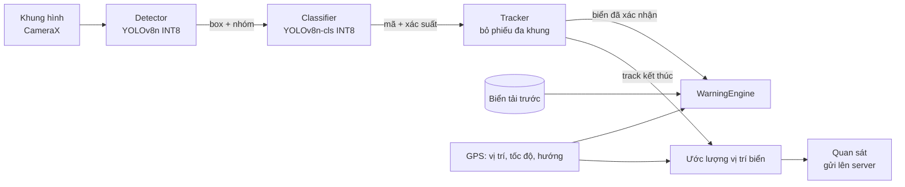
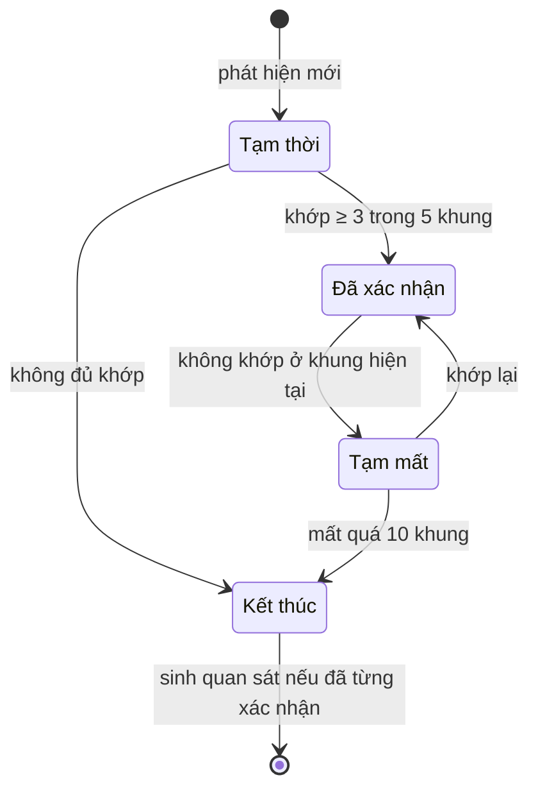
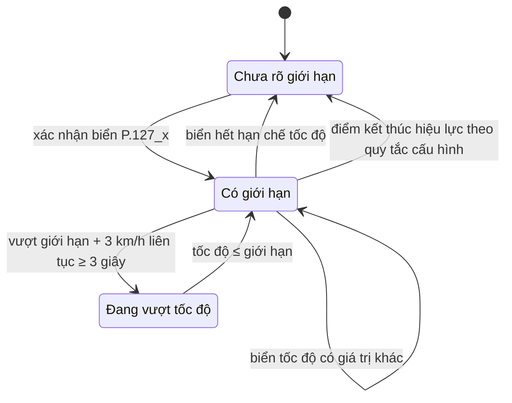
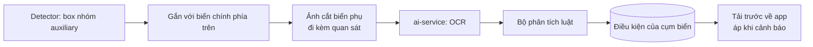
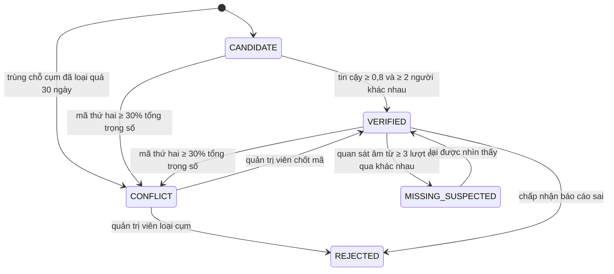
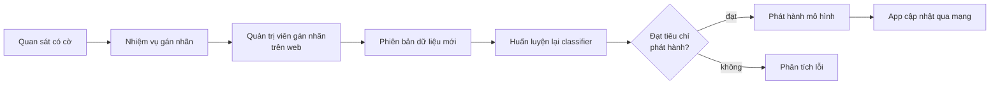

# 04 · Thiết kế AI

Thiết kế toàn bộ phần trí tuệ nhân tạo: từ khung hình camera đến cảnh báo trên điện thoại, và từ quan sát của nhiều xe đến bản đồ biển báo có điểm tin cậy.

## Mục lục

1. [Tổng quan chuỗi xử lý](#1-tổng-quan-chuỗi-xử-lý)
2. [Tầng phát hiện](#2-tầng-phát-hiện)
3. [Tầng phân loại](#3-tầng-phân-loại)
4. [Theo dõi đa khung hình](#4-theo-dõi-đa-khung-hình)
5. [Máy trạng thái cảnh báo](#5-máy-trạng-thái-cảnh-báo)
6. [Đọc biển phụ](#6-đọc-biển-phụ)
7. [Ước lượng vị trí biển](#7-ước-lượng-vị-trí-biển)
8. [Gom cụm và điểm tin cậy](#8-gom-cụm-và-điểm-tin-cậy)
9. [Vòng lặp dữ liệu](#9-vòng-lặp-dữ-liệu)
10. [Phát hành mô hình](#10-phát-hành-mô-hình)
11. [Rủi ro kỹ thuật](#11-rủi-ro-kỹ-thuật)

## 1. Tổng quan chuỗi xử lý



Ngân sách thời gian cho một khung hình để đạt NFR-01 (15 FPS) là 66 ms:

| Bước | Ngân sách | Ghi chú |
| --- | --- | --- |
| Tiền xử lý (YUV → RGB, resize) | ≤ 8 ms | Làm trên GPU nếu được |
| Detector | ≤ 35 ms | GPU delegate, dự phòng CPU (XNNPACK) |
| Classifier | ≤ 3 ms mỗi ảnh cắt, tối đa 3 ảnh cắt mỗi khung | Chỉ chạy cho track mới hoặc chưa chắc chắn |
| Tracker + cảnh báo | ≤ 3 ms | Thuần Kotlin |
| Dự phòng | ≥ 10 ms | |

CameraX dùng chiến lược `STRATEGY_KEEP_ONLY_LATEST`: khi xử lý chậm, khung cũ bị bỏ thay vì dồn hàng đợi.

## 2. Tầng phát hiện

| Hạng mục | Thiết kế |
| --- | --- |
| Mô hình | YOLOv8n (anchor-free), khởi tạo từ trọng số tiền huấn luyện COCO |
| Đầu vào | 640 × 640, letterbox; thử nghiệm 960 px cho biển nhỏ |
| Lớp đầu ra | 5 nhóm: `prohibitory` (tròn viền đỏ), `mandatory` (tròn nền xanh), `warning` (tam giác viền đỏ nền vàng), `auxiliary` (biển phụ), `other` |
| Hậu xử lý | NMS IoU 0,5; ngưỡng tin cậy chọn trên tập validation theo hướng ưu tiên recall, vì tracker lọc nhiễu |
| Xuất mô hình | TFLite INT8 lượng tử hoá toàn phần với tập đại diện ≥ 200 ảnh validation; FP16 nếu INT8 làm mAP giảm ≥ 2 điểm |

**Vì sao phát hiện theo nhóm:** năm nhóm khác nhau rõ về hình dạng và màu, mỗi nhóm có nhiều mẫu nên detector học ổn định; khác biệt nhỏ giữa các mã (ví dụ các mức tốc độ) để tầng phân loại xử lý trên ảnh cắt rõ hơn. Lý do đầy đủ: [ADR-0003](adr/0003-mo-hinh-hai-tang.md).

**Tăng dữ liệu cho detector bằng nhãn giả:** mô hình thầy YOLOv8m (960 px) chạy trên các khung chưa gán nhãn từ video thực địa; phát hiện có độ tin cậy cao được dùng làm nhãn giả để huấn luyện YOLOv8n. Đây là một thí nghiệm, chỉ giữ lại nếu cải thiện mAP trên tập test.

## 3. Tầng phân loại

| Hạng mục | Thiết kế |
| --- | --- |
| Mô hình | YOLOv8n-cls (Ultralytics), tiền huấn luyện ImageNet; cùng bộ công cụ với detector nên xuất thẳng TFLite INT8 |
| Đầu vào | Ảnh cắt từ box detector, nới 10% mỗi cạnh, giữ tỉ lệ, đệm thành 96 × 96 |
| Lớp đầu ra | Toàn bộ mã trong label map (ví dụ `P.123a`, `P.127_50`) và lớp `unknown` |
| Huấn luyện | Cross-entropy, label smoothing 0,1; lấy mẫu cân bằng theo lớp; thêm ảnh tổng hợp cho lớp hiếm ([Dữ liệu §7](05-du-lieu.md#7-dữ-liệu-tổng-hợp)) |
| Hiệu chỉnh | Temperature scaling trên tập validation, để xác suất phản ánh đúng tỉ lệ đúng (đo bằng ECE) |
| Từ chối | Xác suất lớn nhất < 0,5 thì trả `unknown` |
| Kiểm tra chéo | Nhóm của mã dự đoán khác nhóm detector thì đánh dấu `MISMATCH`, giảm độ tin cậy, đưa vào vòng lặp dữ liệu |

Biển tốc độ tối đa được tách theo giá trị (`P.127_30`, `P.127_40`, …) vì cảnh báo cần đúng con số.

## 4. Theo dõi đa khung hình

Một biển xuất hiện trong nhiều khung liên tiếp khi xe tiến tới. Tracker gom các phát hiện đó thành một **track** để: không cảnh báo vì nhiễu một khung, bỏ phiếu nhãn từ nhiều góc nhìn, và sinh đúng một quan sát cho mỗi biển.

**Ghép phát hiện vào track** theo nguyên lý ByteTrack:

1. Dự đoán vị trí box của mỗi track bằng bộ lọc Kalman vận tốc không đổi.
2. Ghép các phát hiện độ tin cậy cao với track theo IoU (thuật toán Hungary).
3. Ghép tiếp các phát hiện độ tin cậy thấp với các track còn lại.
4. Phát hiện độ tin cậy cao chưa ghép được thì tạo track mới.

**Trạng thái track:**



**Bỏ phiếu nhãn:** mỗi lần chạy classifier cho một track, cộng xác suất của từng mã, nhân trọng số theo diện tích box (biển càng gần càng rõ). Nhãn của track là mã có tổng lớn nhất nếu chiếm ≥ 60% tổng phiếu; nếu không, track mang trạng thái `SPLIT_VOTE`, không sinh cảnh báo theo mã, và được đưa vào vòng lặp dữ liệu.

**Lịch chạy classifier** để giữ ngân sách thời gian: chạy khi track mới tạo, khi diện tích box tăng ≥ 1,5 lần so với lần phân loại trước, hoặc khi phiếu chưa đạt ngưỡng; tối đa 3 ảnh cắt mỗi khung.

**Khi track kết thúc** sinh một quan sát gồm: phân bố xác suất top-3, ảnh cắt tốt nhất (box lớn nhất có xác suất cao), ảnh cắt biển phụ nếu có, vị trí ước lượng (§7), hướng đi, số khung, phiên bản mô hình.

| Tham số | Giá trị khởi đầu | Hiệu chỉnh trên |
| --- | --- | --- |
| Số khung khớp để xác nhận | 3 trong 5 | Video thực địa |
| Số khung mất tối đa | 10 | Video thực địa |
| IoU tối thiểu khi ghép | 0,3 | Video thực địa |
| Tỉ lệ phiếu tối thiểu | 0,6 | Tập validation |

## 5. Máy trạng thái cảnh báo

`WarningEngine` nhận biển đã xác nhận từ tracker, biển tải trước từ bản đồ và dữ liệu GPS, rồi quyết định nói gì và khi nào.

**Trạng thái giới hạn tốc độ:**



Điểm kết thúc hiệu lực của biển tốc độ (chỉ biển hết hạn chế, hay cả nút giao) được cấu hình theo kết quả đối chiếu QCVN 41 — xem [SRS §9, Q2](02-dac-ta-yeu-cau.md#9-vấn-đề-cần-làm-rõ). Khi chưa rõ giới hạn, hệ thống không cảnh báo tốc độ để tránh báo sai.

**Luật cảnh báo:**

| Sự kiện | Điều kiện | Câu đọc | Ưu tiên | Chống lặp |
| --- | --- | --- | --- | --- |
| Vượt tốc độ | Trạng thái `Đang vượt tốc độ` | "Vượt tốc độ, giới hạn {v}" | 1 | Nhắc lại sau 30 giây nếu vẫn vượt |
| Biển tốc độ mới | Xác nhận biển tốc độ khác giới hạn hiện tại | "Giới hạn {v}" | 2 | Mỗi biển một lần |
| Biển cấm phía trước | Biển áp dụng cho loại xe và thời điểm hiện tại, trong phạm vi cảnh báo | "Phía trước {tên biển}" | 2 | Mỗi biển một lần mỗi lượt đi qua |
| Biển nguy hiểm | Trong phạm vi cảnh báo | "Chú ý, {tên biển}" | 3 | Mỗi biển một lần mỗi lượt đi qua |
| Biển phụ chưa đọc được | Biển chính có biển phụ nhưng không có điều kiện | Thêm "có biển phụ, chú ý điều kiện" | — | — |

- **Phạm vi cảnh báo** = max(50 m, tốc độ × 6 giây), đo theo hướng đi.
- **Biển từ bản đồ** chỉ dùng cụm `VERIFIED` có hướng lệch ≤ 45° so với hướng đi; nếu camera đã xác nhận cùng biển thì không đọc lại.
- **Hàng đợi giọng nói:** tối đa một câu mỗi 4 giây; câu ưu tiên cao chen trước; câu chờ quá 5 giây bị bỏ vì đã lỗi thời.

## 6. Đọc biển phụ



**Gắn biển phụ với biển chính:** box biển phụ nằm dưới box biển chính, phần chồng theo chiều ngang ≥ 50% chiều rộng box hẹp hơn, khoảng cách dọc ≤ 0,5 lần chiều cao biển chính.

**Trên thiết bị** không chạy OCR để giữ ngân sách thời gian; ảnh cắt biển phụ được gửi kèm quan sát. **Trên server**, ai-service chạy OCR tiếng Việt (PaddleOCR hoặc VietOCR, chọn qua thí nghiệm), chuẩn hoá chữ, rồi phân tích bằng luật:

| Mẫu chữ | Kết quả |
| --- | --- |
| `6h-22h`, `6h30 - 22h`, `Từ 6h đến 22h` | `timeWindows: [{from: "06:00", to: "22:00"}]` |
| `Ô tô`, `Xe tải`, `Xe khách`, `Xe con` | `vehicles.include` |
| `Trừ xe buýt`, `Ngoại trừ …` | `vehicles.exclude` |
| `Cách 200 m` | `distanceAheadM: 200` |
| `Đoạn đường dài 500 m` | `zoneLengthM: 500` |
| `> 10T` | `weightLimitTon: 10` |

Không phân tích được thì lưu chuỗi gốc, `conditions = null`. Điều kiện gắn với cụm biển trên server, được tải trước về app và áp dụng khi cảnh báo (FR-16).

## 7. Ước lượng vị trí biển

Toạ độ GPS là vị trí xe, không phải vị trí biển. Vị trí biển được ước lượng từ nhiều khung của cùng một track:

1. **Khoảng cách** từ chiều cao box: `d = f_px × H_thực / h_px`, với `f_px` lấy từ thông số camera (hoặc suy ra từ góc nhìn) và `H_thực` là kích thước chuẩn theo nhóm biển trong label map.
2. **Hướng** tới biển: `hướng xe + atan((x_tâm − W/2) / f_px)`.
3. **Vị trí** mỗi khung: dịch toạ độ GPS của khung đó theo khoảng cách và hướng trên (xấp xỉ mặt phẳng cục bộ).
4. **Gộp**: trung vị có trọng số theo kích thước box trên tất cả các khung, để loại các khung sai số lớn.

Hướng của biển được lấy bằng hướng đi của xe, dùng khi gom cụm (§8) và khi chọn biển phía trước (§5). Sai số mục tiêu: trung vị ≤ 10 m so với vị trí thật, đo theo [Kiểm thử §5](08-kiem-thu.md#5-thử-nghiệm-thực-địa).

## 8. Gom cụm và điểm tin cậy

Chạy trong sign-service. Mỗi quan sát dương được gán vào một **cụm biển** — đại diện cho một biển thật.

**Gán cụm:** tìm cụm cùng nhóm biển, cách ≤ 20 m, hướng lệch ≤ 45°; chọn cụm gần nhất; không có thì tạo cụm mới trạng thái `CANDIDATE`. Cụm bị loại trong vòng 30 ngày vẫn nhận quan sát và giữ `REJECTED`, để quyết định của quản trị viên có hiệu lực. Quá 30 ngày, quan sát tại chỗ đó tạo cụm mới ở `CONFLICT` để quản trị viên xét lại, không tự được công nhận lại. Một cụm có thể nhận quan sát với nhiều mã khác nhau; mỗi mã có tổng trọng số riêng.

**Trọng số một quan sát:** `w = p × r × k`, trong đó:

- `p`: xác suất (đã hiệu chỉnh) của mã được quan sát;
- `r`: uy tín người gửi, trong khoảng [0,5; 1,5], khởi đầu 1,0;
- `k`: hệ số chống lặp — mỗi người góp trọng số tối đa một lần mỗi 12 giờ cho một cụm (quan sát trong 12 giờ sau đó có `k = 0`). Mốc thời gian là giờ server nhận quan sát, vì thời điểm do app gửi lên có thể bị sửa. Một người đi qua nhiều ngày vẫn được tính, nhưng một tài khoản không thể tự đẩy cụm lên `VERIFIED` trong một lần.

**Điểm tin cậy** của mã dẫn đầu `c*` là kỳ vọng hậu nghiệm của phân phối Beta:

```math
\alpha = 1 + W_{c^*}, \qquad
\beta = 1 + \sum_{c \ne c^*} W_c + W_{\text{âm}}, \qquad
\text{tin cậy} = \frac{\alpha}{\alpha + \beta}
```

với `W_c` là tổng trọng số các quan sát mã `c`, `W_âm` là tổng trọng số các quan sát âm (đi qua mà không thấy biển).

**Trạng thái cụm:**



Cụm `CONFLICT` giữ nguyên trạng thái cho tới khi quản trị viên chốt mã hoặc loại cụm, kể cả khi bằng chứng sau đó nghiêng hẳn về một mã.

**Quan sát âm** được tạo trên thiết bị, không cần gửi lộ trình: app biết các cụm đã tải trước; khi xe đến gần trong 20 m một cụm cùng chiều đi, ở phía trước, rồi ra xa quá 50 m mà camera không xác nhận biển cùng mã trong 30 giây, app gửi quan sát âm kèm mã cụm. Biển dựng cho chiều ngược lại không được xét vì camera không nhìn thấy mặt biển. Việc đã đi qua được xét theo khoảng cách chứ không theo hướng, vì xe đứng yên thì GPS không có hướng.

**Cập nhật uy tín** khi quản trị viên giải quyết một cụm: người có quan sát đúng `r += 0,05`, người có quan sát sai `r −= 0,1`, giới hạn trong [0,5; 1,5].

**Vị trí cụm** là trung vị có trọng số của vị trí các quan sát thành viên.

**Phương án đối chứng** để đánh giá (mục tiêu G4): khử trùng theo bán kính cố định 20 m — quan sát cùng mã trong bán kính bị coi là trùng, quan sát đầu tiên được công nhận ngay. Hai phương án được chạy trên cùng dữ liệu, so sánh theo [Kiểm thử §6](08-kiem-thu.md#6-đánh-giá-bản-đồ-tự-xác-minh). Lý do lựa chọn: [ADR-0004](adr/0004-diem-tin-cay-ban-do.md).

## 9. Vòng lặp dữ liệu



| Cờ | Điều kiện | Mục đích |
| --- | --- | --- |
| `LOW_CONF` | Xác suất mã dẫn đầu sau bỏ phiếu < 0,6 | Ca mô hình chưa chắc |
| `MISMATCH` | Nhóm của mã khác nhóm detector | Lỗi giữa hai tầng |
| `SPLIT_VOTE` | Tỉ lệ phiếu của mã dẫn đầu < 0,6 | Mô hình dao động giữa các mã |
| `CONFLICT` | Quan sát thuộc cụm `CONFLICT` | Ca người lái cũng không thống nhất |
| `RANDOM` | Lấy ngẫu nhiên 1% quan sát | Đo chất lượng không thiên lệch |

Ảnh cắt từ người dùng chỉ cải thiện được **classifier**. Detector cần khung hình đầy đủ, nên được cải thiện bằng video thực địa của nhóm ([Dữ liệu §4](05-du-lieu.md#4-video-thực-địa)) — hệ quả của việc không gửi khung hình lên server ([ADR-0006](adr/0006-luu-anh-cat-tren-minio.md)).

## 10. Phát hành mô hình

**Phiên bản** `model-vMAJOR.MINOR`: tăng `MAJOR` khi label map thay đổi (không tương thích ngược), tăng `MINOR` khi chỉ huấn luyện lại.

**Thẻ mô hình** (model card) đi kèm mỗi phiên bản: phiên bản dữ liệu, phiên bản label map, cấu hình huấn luyện, chỉ số trên tập test và tập thực địa, kích thước, FPS trên thiết bị tham chiếu, các hạn chế đã biết.

**Tiêu chí phát hành:**

- [ ] mAP@0.5 không thấp hơn mô hình đang dùng
- [ ] Recall nhóm biển cấm và biển tốc độ ≥ 0,90
- [ ] Bản INT8 giảm < 2 điểm mAP so với FP32
- [ ] ≥ 15 FPS trên thiết bị tham chiếu
- [ ] Số cảnh báo sai trên video thực địa không tăng

**Phân phối:** tải mô hình lên MinIO (bucket `models`), đăng ký trong bảng `model_versions` với trạng thái `DRAFT`, chuyển `ACTIVE` khi phát hành. Quay lui bằng cách đặt lại phiên bản trước thành `ACTIVE`.

## 11. Rủi ro kỹ thuật

| Rủi ro | Ảnh hưởng | Cách giảm |
| --- | --- | --- |
| Dữ liệu ban đêm, trời mưa ít | Recall giảm mạnh trong điều kiện xấu | Thu thập riêng, tăng cường dữ liệu, báo cáo chỉ số theo điều kiện |
| Biển nhỏ, ở xa | Phát hiện muộn, không kịp cảnh báo | Thí nghiệm 960 px; cảnh báo sớm từ bản đồ tải trước |
| Máy yếu, máy nóng | FPS < 15 | Bỏ khung, lịch chạy classifier, INT8, giảm tần suất khi nhiệt cao |
| Cảnh báo sai gây phiền | Người dùng tắt ứng dụng | Xác nhận đa khung, hàng đợi ưu tiên, chống lặp, đo cảnh báo sai mỗi 10 km |
| Quan sát sai hoặc cố ý phá | Bản đồ sai | Trọng số uy tín, yêu cầu ≥ 2 người khác nhau, quản trị viên xử lý mâu thuẫn |
| Label map thay đổi | App cũ hiểu sai mã | Phiên bản `MAJOR`, kiểm tra tương thích trước khi cập nhật |
| GPS sai số trong phố hẹp | Vị trí biển lệch | Trung vị theo nhiều khung và nhiều người |
