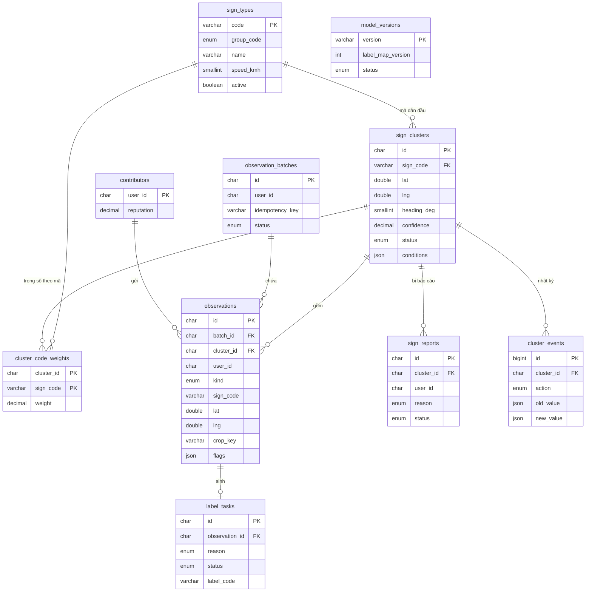

# 06 · Cơ sở dữ liệu

## Mục lục

1. [Tổng quan](#1-tổng-quan)
2. [auth_db](#2-auth_db)
3. [sign_db](#3-sign_db)
4. [Khoá Redis](#4-khoá-redis)
5. [Truy vấn không gian](#5-truy-vấn-không-gian)
6. [Quy ước migration](#6-quy-ước-migration)

## 1. Tổng quan

| CSDL | Service sở hữu | Nội dung |
| --- | --- | --- |
| `auth_db` | auth-service | Tài khoản người dùng |
| `sign_db` | sign-service | Danh mục biển, quan sát, cụm biển, báo cáo, gán nhãn, phiên bản mô hình |

- MySQL 8, InnoDB, `utf8mb4`.
- Khoá chính dạng UUID lưu `CHAR(36)`, trừ bảng nhật ký dùng `BIGINT AUTO_INCREMENT`.
- Thời gian lưu `DATETIME(3)` theo UTC.
- Toạ độ lưu hai cột `lat`, `lng` (DOUBLE) với chỉ mục `(lat, lng)`; truy vấn vùng bằng `BETWEEN`, khoảng cách chính xác tính trong mã.
- Migration trong `*/src/main/resources/db/migration` là nguồn chuẩn của lược đồ. `V3__ai_review_and_models.sql` thêm hàng đợi AI, gán nhãn và phát hành mô hình.
- Liên kết giữa hai CSDL chỉ qua ID (`user_id`), không có khoá ngoại chéo.

## 2. auth_db

### users

| Cột | Kiểu | Ràng buộc | Mô tả |
| --- | --- | --- | --- |
| `id` | CHAR(36) | PK | UUID |
| `email` | VARCHAR(255) | UNIQUE, NOT NULL | Email đăng nhập |
| `password_hash` | VARCHAR(100) | NOT NULL | BCrypt |
| `display_name` | VARCHAR(100) | NOT NULL | Tên hiển thị |
| `role` | ENUM('DRIVER','ADMIN') | NOT NULL, mặc định `DRIVER` | Vai trò |
| `vehicle_type` | ENUM('CAR','BUS','TRUCK') | NOT NULL, mặc định `CAR` | Loại xe, dùng cho điều kiện cảnh báo |
| `status` | ENUM('ACTIVE','LOCKED') | NOT NULL, mặc định `ACTIVE` | Trạng thái tài khoản |
| `created_at` | DATETIME(3) | NOT NULL | |
| `updated_at` | DATETIME(3) | NOT NULL | |

## 3. sign_db

### Sơ đồ quan hệ



### sign_types

| Cột | Kiểu | Ràng buộc | Mô tả |
| --- | --- | --- | --- |
| `code` | VARCHAR(20) | PK | Mã QCVN 41, ví dụ `P.127_50` |
| `group_code` | ENUM('PROHIBITORY','MANDATORY','WARNING','AUXILIARY','OTHER') | NOT NULL | Nhóm biển |
| `name` | VARCHAR(200) | NOT NULL | Tên biển |
| `description` | TEXT | | Ý nghĩa, hiệu lực |
| `speed_kmh` | SMALLINT | NULL | Giá trị tốc độ, chỉ với biển tốc độ |
| `icon_key` | VARCHAR(255) | NULL | Khoá ảnh minh hoạ trên MinIO |
| `label_map_version` | INT | NOT NULL | Phiên bản danh mục đưa mã này vào |
| `active` | BOOLEAN | NOT NULL, mặc định TRUE | Ngừng dùng thay vì xoá |
| `created_at`, `updated_at` | DATETIME(3) | NOT NULL | |

### sign_clusters

| Cột | Kiểu | Ràng buộc | Mô tả |
| --- | --- | --- | --- |
| `id` | CHAR(36) | PK | |
| `sign_code` | VARCHAR(20) | FK → `sign_types.code`, NOT NULL | Mã dẫn đầu |
| `lat`, `lng` | DOUBLE | NOT NULL, INDEX `(lat, lng)` | Vị trí cụm |
| `heading_deg` | SMALLINT | NOT NULL | Hướng đi mà biển áp dụng, 0–359 |
| `alpha`, `beta` | DECIMAL(10,3) | NOT NULL | Tham số Beta |
| `confidence` | DECIMAL(4,3) | NOT NULL, INDEX | `alpha / (alpha + beta)` |
| `status` | ENUM('CANDIDATE','VERIFIED','CONFLICT','MISSING_SUSPECTED','REJECTED') | NOT NULL, INDEX | |
| `conditions` | JSON | NULL | Điều kiện biển phụ |
| `observation_count` | INT | NOT NULL | |
| `distinct_users` | INT | NOT NULL | |
| `representative_obs_id` | CHAR(36) | NULL | Quan sát có ảnh cắt đại diện |
| `last_seen_at` | DATETIME(3) | NOT NULL | |
| `version` | INT | NOT NULL | Khoá lạc quan khi nhiều worker cập nhật |
| `created_at`, `updated_at` | DATETIME(3) | NOT NULL | |

### cluster_code_weights

| Cột | Kiểu | Ràng buộc | Mô tả |
| --- | --- | --- | --- |
| `cluster_id` | CHAR(36) | PK, FK → `sign_clusters.id` | |
| `sign_code` | VARCHAR(20) | PK, FK → `sign_types.code` | |
| `weight` | DECIMAL(10,3) | NOT NULL | Tổng trọng số quan sát của mã này |

### observation_batches

| Cột | Kiểu | Ràng buộc | Mô tả |
| --- | --- | --- | --- |
| `id` | CHAR(36) | PK | |
| `user_id` | CHAR(36) | NOT NULL | |
| `idempotency_key` | VARCHAR(64) | NOT NULL, UNIQUE cùng `user_id` | Chống gửi trùng |
| `status` | ENUM('PENDING_UPLOAD','QUEUED','PROCESSED','FAILED') | NOT NULL | |
| `observation_count` | INT | NOT NULL | |
| `created_at` | DATETIME(3) | NOT NULL | |
| `processed_at` | DATETIME(3) | NULL | |

### observations

| Cột | Kiểu | Ràng buộc | Mô tả |
| --- | --- | --- | --- |
| `id` | CHAR(36) | PK | |
| `batch_id` | CHAR(36) | FK → `observation_batches.id` | |
| `cluster_id` | CHAR(36) | FK → `sign_clusters.id`, NULL | Gán sau khi gom cụm |
| `user_id` | CHAR(36) | NOT NULL, INDEX cùng `observed_at` | |
| `kind` | ENUM('POSITIVE','NEGATIVE') | NOT NULL | Quan sát âm: đi qua mà không thấy |
| `sign_code` | VARCHAR(20) | NULL | NULL với quan sát âm |
| `detector_group` | VARCHAR(20) | NULL | Nhóm do detector trả |
| `class_probs` | JSON | NULL | Top-3 mã và xác suất |
| `vote_share` | DECIMAL(4,3) | NULL | Tỉ lệ phiếu của mã dẫn đầu |
| `lat`, `lng` | DOUBLE | NOT NULL | Vị trí biển ước lượng |
| `heading_deg` | SMALLINT | NOT NULL | Hướng đi |
| `distance_m` | DECIMAL(6,1) | NULL | Khoảng cách ước lượng tới biển |
| `frames` | INT | NULL | Số khung của track |
| `crop_key` | VARCHAR(255) | NULL | Ảnh cắt trên MinIO |
| `sub_sign_key` | VARCHAR(255) | NULL | Ảnh cắt biển phụ |
| `flags` | JSON | NULL | `LOW_CONF`, `MISMATCH`, `SPLIT_VOTE`, … |
| `model_version` | VARCHAR(20) | NOT NULL | |
| `label_map_version` | INT | NOT NULL | |
| `device_model` | VARCHAR(100) | NULL | |
| `observed_at` | DATETIME(3) | NOT NULL | Thời điểm nhìn thấy |
| `created_at` | DATETIME(3) | NOT NULL | |

### contributors

| Cột | Kiểu | Ràng buộc | Mô tả |
| --- | --- | --- | --- |
| `user_id` | CHAR(36) | PK | |
| `reputation` | DECIMAL(3,2) | NOT NULL, mặc định 1.00 | Trong khoảng [0,5; 1,5] |
| `observations_total` | INT | NOT NULL | |
| `agreed`, `disagreed` | INT | NOT NULL | Số lần đúng / sai khi quản trị viên giải quyết |
| `updated_at` | DATETIME(3) | NOT NULL | |

### sign_reports

| Cột | Kiểu | Ràng buộc | Mô tả |
| --- | --- | --- | --- |
| `id` | CHAR(36) | PK | |
| `cluster_id` | CHAR(36) | FK → `sign_clusters.id` | |
| `user_id` | CHAR(36) | NOT NULL | |
| `reason` | ENUM('NOT_EXIST','WRONG_TYPE','WRONG_POSITION','OTHER') | NOT NULL | |
| `note` | VARCHAR(500) | NULL | |
| `status` | ENUM('PENDING','ACCEPTED','REJECTED') | NOT NULL | |
| `resolution_note` | VARCHAR(500) | NULL | Bắt buộc khi từ chối |
| `resolved_by` | CHAR(36) | NULL | |
| `resolved_at` | DATETIME(3) | NULL | |
| `created_at` | DATETIME(3) | NOT NULL | |

### cluster_events

| Cột | Kiểu | Ràng buộc | Mô tả |
| --- | --- | --- | --- |
| `id` | BIGINT | PK, AUTO_INCREMENT | |
| `cluster_id` | CHAR(36) | FK → `sign_clusters.id`, INDEX | |
| `actor_type` | ENUM('SYSTEM','ADMIN') | NOT NULL | |
| `actor_id` | CHAR(36) | NULL | Quản trị viên thực hiện |
| `action` | ENUM('CREATED','STATUS_CHANGED','CODE_CHANGED','CONDITIONS_CHANGED','REJECTED') | NOT NULL | |
| `old_value`, `new_value` | JSON | NULL | |
| `reason` | VARCHAR(500) | NULL | |
| `created_at` | DATETIME(3) | NOT NULL | |

### label_tasks

| Cột | Kiểu | Ràng buộc | Mô tả |
| --- | --- | --- | --- |
| `id` | CHAR(36) | PK | |
| `observation_id` | CHAR(36) | FK → `observations.id`, UNIQUE | |
| `reason` | VARCHAR(32) | NOT NULL | LOW_CONF, MISMATCH, SPLIT_VOTE, CONFLICT, RANDOM, OCR_UNPARSED, AI_UNAVAILABLE |
| `status` | ENUM('OPEN','LABELED','SKIPPED') | NOT NULL, INDEX | |
| `label_code` | VARCHAR(20) | NULL | Mã do quản trị viên chọn |
| `label_box` | JSON | NULL | Box đã sửa trong ảnh cắt |
| `ocr_text`, `conditions` | TEXT, JSON | NULL | Chữ và điều kiện biển phụ đã duyệt tay |
| `resolved_by` | CHAR(36) | NULL | |
| `resolved_at` | DATETIME(3) | NULL | |
| `created_at` | DATETIME(3) | NOT NULL | |

### model_versions

| Cột | Kiểu | Ràng buộc | Mô tả |
| --- | --- | --- | --- |
| `version` | VARCHAR(20) | PK | `model-vX.Y` |
| `label_map_version` | INT | NOT NULL | |
| `detector_key`, `classifier_key` | VARCHAR(255) | NOT NULL | Khoá file trên MinIO |
| `detector_sha256`, `classifier_sha256` | CHAR(64) | NOT NULL | |
| `detector_size`, `classifier_size` | BIGINT | NOT NULL | Kích thước từng file |
| `min_app_version` | VARCHAR(32) | NOT NULL | major[.minor[.patch]] |
| `created_by`, `created_at` | CHAR(36), DATETIME(3) | NOT NULL | Người đăng ký và thời điểm |

### Hàng đợi AI và con trỏ phát hành

- `observation_analysis`: khoá chính `observation_id` (FK), `status` (`PENDING`, `PROCESSING`, `RETRY`, `DONE`, `FAILED`), `attempts`, `generation`, `available_at`, `result` JSON và `updated_at`. Trạng thái `PROCESSING` hết lease được worker khác nhận lại; cặp generation/số lần thử ngăn kết quả cũ ghi đè kết quả mới, kể cả sau khi quản trị viên yêu cầu chạy lại.
- `V4__sub_sign_review_and_freshness.sql` thêm `observations.has_sub_sign`, giữ thông tin có biển phụ ngay cả khi ảnh phụ chưa tải được. API cụm trả `hasSubSign` dựa trên các quan sát này.
- `sign_clusters.conditions_confidence`, `conditions_observed_at`, `conditions_observation_id`: ghi nguồn gốc điều kiện OCR. Ảnh mới hơn được ưu tiên khi đạt ngưỡng 0,8; cùng thời điểm thì so confidence và ID để kết quả ổn định. Ảnh cũ đến muộn không ghi đè kết quả mới.
- `sign_clusters.conditions_reviewed`: điều kiện đã duyệt tay; worker AI không ghi đè. Khi mã cụm đổi, toàn bộ điều kiện và metadata liên quan được xóa để tránh áp nhầm điều kiện của mã cũ.
- `model_release`: sau V5 mỗi `label_map_version` có một dòng, `version` FK tới `model_versions`, `activated_by`, `activated_at`. Dòng này là con trỏ phát hành duy nhất, gồm cả quay lui.
- `cluster_ingestion_lock`: một dòng `id=1` để tuần tự hoá đoạn gom cụm trong MySQL giữa các replica. Lời gọi S3/AI không giữ khoá này.

## 4. Khoá Redis

| Khoá | Giá trị | Hết hạn | Service |
| --- | --- | --- | --- |
| `session:{sessionId}` | JSON `{userId, role, vehicleType}` | Có | auth-service ghi; mọi service đọc |
| `otp:{email}` | Băm mã OTP, số lần nhập sai | Có | auth-service |
| `ratelimit:{route}:{key}` | Bộ đếm | Có | Mọi service |
| `cache:vietmap:{hash}` | Kết quả tìm kiếm, chỉ đường | Có | map-service |
| Stream `observations` | `batchId` chờ xử lý | — | sign-service |

## 5. Truy vấn không gian

Biển trong một vùng hình chữ nhật dùng chỉ mục `(lat, lng)`:

```sql
SELECT c.*, t.group_code, t.name FROM sign_clusters c JOIN sign_types t ON t.code = c.sign_code
WHERE c.lat BETWEEN :minLat AND :maxLat AND c.lng BETWEEN :minLng AND :maxLng
  AND c.status IN (:statuses);
```

Khi gom cụm, sign-service lấy các cụm trong ô vuông quanh điểm quan sát rồi tính khoảng cách haversine, độ lệch hướng trong Java (`ClusterRules.pick`). Cách này tránh hẳn lỗi thứ tự trục vĩ độ – kinh độ của kiểu `POINT SRID 4326`.

## 6. Quy ước migration

- Mỗi service quản lý lược đồ của mình bằng Flyway trong `src/main/resources/db/migration`.
- Tên file: `V<số>__<mo_ta_ngan>.sql`, ví dụ `V3__add_cluster_conditions.sql`.
- Không sửa migration đã merge vào `dev`; sai thì viết migration mới.
- Dữ liệu khởi tạo `sign_types` sinh từ `ai/data/labels.yaml` thành migration `R__seed_sign_types.sql`.

## Migration V5 · Đối chiếu vòng dữ liệu

`label_tasks` có `dataset_version VARCHAR(10)` và `ocr_status` (`NOT_REQUIRED/PENDING/REVIEWED/SKIPPED`); nhãn chính được duyệt độc lập với OCR. `model_versions` có `status` (`DRAFT/ACTIVE/RETIRED`), `metrics JSON NOT NULL`, `released_at`; `model_release` khoá chính `label_map_version`. Model cũ thiếu thẻ được đưa về DRAFT khi nâng cấp, không tự nhận đạt tiêu chí phát hành.
