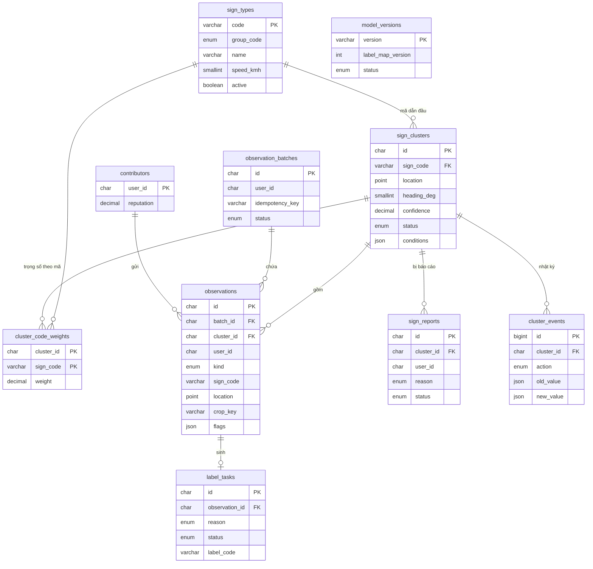

# 06 · Cơ sở dữ liệu

## Mục lục

1. [Tổng quan](#1-tổng-quan)
2. [auth_db](#2-auth_db)
3. [sign_db](#3-sign_db)
4. [Khoá Redis](#4-khoá-redis)
5. [Truy vấn không gian](#5-truy-vấn-không-gian)
6. [Quy ước migration](#6-quy-ước-migration)

## 1. Tổng quan

| CSDL | Service sở hữu | Nội dung |
| --- | --- | --- |
| `auth_db` | auth-service | Tài khoản người dùng |
| `sign_db` | sign-service | Danh mục biển, quan sát, cụm biển, báo cáo, gán nhãn, phiên bản mô hình |

- MySQL 8, InnoDB, `utf8mb4`.
- Khoá chính dạng UUID lưu `CHAR(36)`, trừ bảng nhật ký dùng `BIGINT AUTO_INCREMENT`.
- Thời gian lưu `DATETIME(3)` theo UTC.
- Toạ độ lưu `POINT SRID 4326` có chỉ mục không gian.
- Liên kết giữa hai CSDL chỉ qua ID (`user_id`), không có khoá ngoại chéo.

## 2. auth_db

### users

| Cột | Kiểu | Ràng buộc | Mô tả |
| --- | --- | --- | --- |
| `id` | CHAR(36) | PK | UUID |
| `email` | VARCHAR(255) | UNIQUE, NOT NULL | Email đăng nhập |
| `password_hash` | VARCHAR(100) | NOT NULL | BCrypt |
| `display_name` | VARCHAR(100) | NOT NULL | Tên hiển thị |
| `role` | ENUM('DRIVER','ADMIN') | NOT NULL, mặc định `DRIVER` | Vai trò |
| `vehicle_type` | ENUM('CAR','BUS','TRUCK') | NOT NULL, mặc định `CAR` | Loại xe, dùng cho điều kiện cảnh báo |
| `status` | ENUM('ACTIVE','LOCKED') | NOT NULL, mặc định `ACTIVE` | Trạng thái tài khoản |
| `created_at` | DATETIME(3) | NOT NULL | |
| `updated_at` | DATETIME(3) | NOT NULL | |

## 3. sign_db

### Sơ đồ quan hệ



### sign_types

| Cột | Kiểu | Ràng buộc | Mô tả |
| --- | --- | --- | --- |
| `code` | VARCHAR(20) | PK | Mã QCVN 41, ví dụ `P.127_50` |
| `group_code` | ENUM('PROHIBITORY','MANDATORY','WARNING','AUXILIARY','OTHER') | NOT NULL | Nhóm biển |
| `name` | VARCHAR(200) | NOT NULL | Tên biển |
| `description` | TEXT | | Ý nghĩa, hiệu lực |
| `speed_kmh` | SMALLINT | NULL | Giá trị tốc độ, chỉ với biển tốc độ |
| `icon_key` | VARCHAR(255) | NULL | Khoá ảnh minh hoạ trên MinIO |
| `label_map_version` | INT | NOT NULL | Phiên bản danh mục đưa mã này vào |
| `active` | BOOLEAN | NOT NULL, mặc định TRUE | Ngừng dùng thay vì xoá |
| `created_at`, `updated_at` | DATETIME(3) | NOT NULL | |

### sign_clusters

| Cột | Kiểu | Ràng buộc | Mô tả |
| --- | --- | --- | --- |
| `id` | CHAR(36) | PK | |
| `sign_code` | VARCHAR(20) | FK → `sign_types.code`, NOT NULL | Mã dẫn đầu |
| `location` | POINT SRID 4326 | NOT NULL, SPATIAL INDEX | Vị trí cụm |
| `heading_deg` | SMALLINT | NOT NULL | Hướng đi mà biển áp dụng, 0–359 |
| `alpha`, `beta` | DECIMAL(10,3) | NOT NULL | Tham số Beta |
| `confidence` | DECIMAL(4,3) | NOT NULL, INDEX | `alpha / (alpha + beta)` |
| `status` | ENUM('CANDIDATE','VERIFIED','CONFLICT','MISSING_SUSPECTED','REJECTED') | NOT NULL, INDEX | |
| `conditions` | JSON | NULL | Điều kiện biển phụ |
| `observation_count` | INT | NOT NULL | |
| `distinct_users` | INT | NOT NULL | |
| `representative_obs_id` | CHAR(36) | NULL | Quan sát có ảnh cắt đại diện |
| `last_seen_at` | DATETIME(3) | NOT NULL | |
| `version` | INT | NOT NULL | Khoá lạc quan khi nhiều worker cập nhật |
| `created_at`, `updated_at` | DATETIME(3) | NOT NULL | |

### cluster_code_weights

| Cột | Kiểu | Ràng buộc | Mô tả |
| --- | --- | --- | --- |
| `cluster_id` | CHAR(36) | PK, FK → `sign_clusters.id` | |
| `sign_code` | VARCHAR(20) | PK, FK → `sign_types.code` | |
| `weight` | DECIMAL(10,3) | NOT NULL | Tổng trọng số quan sát của mã này |

### observation_batches

| Cột | Kiểu | Ràng buộc | Mô tả |
| --- | --- | --- | --- |
| `id` | CHAR(36) | PK | |
| `user_id` | CHAR(36) | NOT NULL | |
| `idempotency_key` | VARCHAR(64) | NOT NULL, UNIQUE cùng `user_id` | Chống gửi trùng |
| `status` | ENUM('PENDING_UPLOAD','QUEUED','PROCESSED','FAILED') | NOT NULL | |
| `observation_count` | INT | NOT NULL | |
| `created_at` | DATETIME(3) | NOT NULL | |
| `processed_at` | DATETIME(3) | NULL | |

### observations

| Cột | Kiểu | Ràng buộc | Mô tả |
| --- | --- | --- | --- |
| `id` | CHAR(36) | PK | |
| `batch_id` | CHAR(36) | FK → `observation_batches.id` | |
| `cluster_id` | CHAR(36) | FK → `sign_clusters.id`, NULL | Gán sau khi gom cụm |
| `user_id` | CHAR(36) | NOT NULL, INDEX cùng `observed_at` | |
| `kind` | ENUM('POSITIVE','NEGATIVE') | NOT NULL | Quan sát âm: đi qua mà không thấy |
| `sign_code` | VARCHAR(20) | NULL | NULL với quan sát âm |
| `detector_group` | VARCHAR(20) | NULL | Nhóm do detector trả |
| `class_probs` | JSON | NULL | Top-3 mã và xác suất |
| `vote_share` | DECIMAL(4,3) | NULL | Tỉ lệ phiếu của mã dẫn đầu |
| `location` | POINT SRID 4326 | NOT NULL, SPATIAL INDEX | Vị trí biển ước lượng |
| `heading_deg` | SMALLINT | NOT NULL | Hướng đi |
| `distance_m` | DECIMAL(6,1) | NULL | Khoảng cách ước lượng tới biển |
| `frames` | INT | NULL | Số khung của track |
| `crop_key` | VARCHAR(255) | NULL | Ảnh cắt trên MinIO |
| `sub_sign_key` | VARCHAR(255) | NULL | Ảnh cắt biển phụ |
| `flags` | JSON | NULL | `LOW_CONF`, `MISMATCH`, `SPLIT_VOTE`, … |
| `model_version` | VARCHAR(20) | NOT NULL | |
| `label_map_version` | INT | NOT NULL | |
| `device_model` | VARCHAR(100) | NULL | |
| `observed_at` | DATETIME(3) | NOT NULL | Thời điểm nhìn thấy |
| `created_at` | DATETIME(3) | NOT NULL | |

### contributors

| Cột | Kiểu | Ràng buộc | Mô tả |
| --- | --- | --- | --- |
| `user_id` | CHAR(36) | PK | |
| `reputation` | DECIMAL(3,2) | NOT NULL, mặc định 1.00 | Trong khoảng [0,5; 1,5] |
| `observations_total` | INT | NOT NULL | |
| `agreed`, `disagreed` | INT | NOT NULL | Số lần đúng / sai khi quản trị viên giải quyết |
| `updated_at` | DATETIME(3) | NOT NULL | |

### sign_reports

| Cột | Kiểu | Ràng buộc | Mô tả |
| --- | --- | --- | --- |
| `id` | CHAR(36) | PK | |
| `cluster_id` | CHAR(36) | FK → `sign_clusters.id` | |
| `user_id` | CHAR(36) | NOT NULL | |
| `reason` | ENUM('NOT_EXIST','WRONG_TYPE','WRONG_POSITION','OTHER') | NOT NULL | |
| `note` | VARCHAR(500) | NULL | |
| `status` | ENUM('PENDING','ACCEPTED','REJECTED') | NOT NULL | |
| `resolution_note` | VARCHAR(500) | NULL | Bắt buộc khi từ chối |
| `resolved_by` | CHAR(36) | NULL | |
| `resolved_at` | DATETIME(3) | NULL | |
| `created_at` | DATETIME(3) | NOT NULL | |

### cluster_events

| Cột | Kiểu | Ràng buộc | Mô tả |
| --- | --- | --- | --- |
| `id` | BIGINT | PK, AUTO_INCREMENT | |
| `cluster_id` | CHAR(36) | FK → `sign_clusters.id`, INDEX | |
| `actor_type` | ENUM('SYSTEM','ADMIN') | NOT NULL | |
| `actor_id` | CHAR(36) | NULL | Quản trị viên thực hiện |
| `action` | ENUM('CREATED','STATUS_CHANGED','CODE_CHANGED','CONDITIONS_CHANGED','REJECTED') | NOT NULL | |
| `old_value`, `new_value` | JSON | NULL | |
| `reason` | VARCHAR(500) | NULL | |
| `created_at` | DATETIME(3) | NOT NULL | |

### label_tasks

| Cột | Kiểu | Ràng buộc | Mô tả |
| --- | --- | --- | --- |
| `id` | CHAR(36) | PK | |
| `observation_id` | CHAR(36) | FK → `observations.id`, UNIQUE | |
| `reason` | ENUM('LOW_CONF','MISMATCH','SPLIT_VOTE','CONFLICT','RANDOM') | NOT NULL | |
| `status` | ENUM('OPEN','DONE','SKIPPED') | NOT NULL, INDEX | |
| `suggested_code` | VARCHAR(20) | NULL | |
| `label_code` | VARCHAR(20) | NULL | Mã do quản trị viên chọn |
| `label_box` | JSON | NULL | Box đã sửa trong ảnh cắt |
| `labeled_by` | CHAR(36) | NULL | |
| `labeled_at` | DATETIME(3) | NULL | |
| `dataset_version` | VARCHAR(10) | NULL | Phiên bản dữ liệu đưa nhãn này vào |
| `created_at` | DATETIME(3) | NOT NULL | |

### model_versions

| Cột | Kiểu | Ràng buộc | Mô tả |
| --- | --- | --- | --- |
| `version` | VARCHAR(20) | PK | `model-vX.Y` |
| `label_map_version` | INT | NOT NULL | |
| `detector_key`, `classifier_key` | VARCHAR(255) | NOT NULL | Khoá file trên MinIO |
| `detector_sha256`, `classifier_sha256` | CHAR(64) | NOT NULL | |
| `size_bytes` | BIGINT | NOT NULL | |
| `metrics` | JSON | NOT NULL | Chỉ số trong thẻ mô hình |
| `min_app_version` | VARCHAR(20) | NOT NULL | |
| `status` | ENUM('DRAFT','ACTIVE','RETIRED') | NOT NULL | Chỉ một phiên bản `ACTIVE` cho mỗi label map |
| `released_at` | DATETIME(3) | NULL | |

## 4. Khoá Redis

| Khoá | Giá trị | Hết hạn | Service |
| --- | --- | --- | --- |
| `session:{sessionId}` | JSON `{userId, role, vehicleType}` | Có | auth-service ghi; mọi service đọc |
| `otp:{email}` | Băm mã OTP, số lần nhập sai | Có | auth-service |
| `ratelimit:{route}:{key}` | Bộ đếm | Có | Mọi service |
| `cache:vietmap:{hash}` | Kết quả tìm kiếm, chỉ đường | Có | map-service |
| Stream `observations` | `batchId` chờ xử lý | — | sign-service |

## 5. Truy vấn không gian

Biển trong một vùng hình chữ nhật:

```sql
SELECT id, sign_code, ST_Latitude(location) AS lat, ST_Longitude(location) AS lng, confidence
FROM sign_clusters
WHERE status = 'VERIFIED'
  AND MBRContains(ST_GeomFromText(:bbox_wkt, 4326), location);
```

Cụm ứng viên trong bán kính khi gom cụm:

```sql
SELECT id, heading_deg
FROM sign_clusters
WHERE status <> 'REJECTED'
  AND MBRContains(ST_GeomFromText(:search_box_wkt, 4326), location)
  AND ST_Distance_Sphere(location, ST_GeomFromText(:point_wkt, 4326)) <= 20;
```

> Với SRID 4326, `ST_GeomFromText` của MySQL 8 mặc định đọc toạ độ theo thứ tự **vĩ độ – kinh độ**. Toàn bộ mã dùng chung một hàm tạo WKT, và có test cho các truy vấn không gian.

## 6. Quy ước migration

- Mỗi service quản lý lược đồ của mình bằng Flyway trong `src/main/resources/db/migration`.
- Tên file: `V<số>__<mo_ta_ngan>.sql`, ví dụ `V3__add_cluster_conditions.sql`.
- Không sửa migration đã merge vào `dev`; sai thì viết migration mới.
- Dữ liệu khởi tạo `sign_types` sinh từ `ai/data/labels.yaml` thành migration `R__seed_sign_types.sql`.
