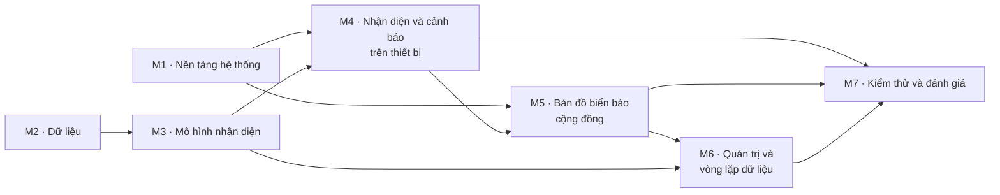

# 09 · Hạng mục công việc

Các chủ đề cần hoàn thành để đồ án đầy đủ. Mỗi chủ đề là một **milestone** trên GitHub; mỗi đầu ra tương ứng một hoặc nhiều **issue**.

## Sơ đồ phụ thuộc

M1 và M2 làm song song từ đầu. M4 cần mô hình từ M3; M5 cần quan sát do M4 sinh ra; M7 tổng hợp kết quả của tất cả.

## M1 · Nền tảng hệ thống

**Mục tiêu:** mọi thành phần có khung mã nguồn chạy được, kiểm thử được và triển khai được bằng Docker.

- [ ] Bộ tài liệu thiết kế được cả nhóm rà soát; ADR chuyển `Accepted`
- [ ] Khung dự án Android theo [mobile/README.md](../mobile/README.md)
- [ ] Gradle multi-project cho backend và thư viện `common`
- [ ] auth-service: đăng ký, đăng nhập, phiên, đổi và quên mật khẩu (FR-12)
- [ ] Màn hình tài khoản trên ứng dụng (FR-12)
- [ ] Khung dự án Python cho `ai/` và web quản trị
- [ ] Docker Compose chạy MySQL, Redis, MinIO và các service
- [ ] CI build, lint, test cho mọi thành phần

**Hoàn thành khi:** `docker compose up` chạy đủ hạ tầng; người dùng đăng ký và đăng nhập được từ ứng dụng; CI xanh.

## M2 · Dữ liệu

**Mục tiêu:** có dữ liệu đủ và đúng để huấn luyện và đánh giá theo [Dữ liệu và gán nhãn](05-du-lieu.md).

- [ ] Danh mục nhãn `labels.yaml` v1, đối chiếu QCVN 41
- [ ] Dữ liệu công khai đã kiểm tra giấy phép và gán nhãn lại theo danh mục
- [ ] Video thực địa ban ngày, ban đêm, trời mưa kèm GPS và nhãn chuẩn của từng tuyến
- [ ] Tập kiểm thử thực địa đã gán nhãn
- [ ] Dữ liệu tổng hợp cho lớp hiếm
- [ ] Script kiểm tra dữ liệu và sinh manifest có hash

**Hoàn thành khi:** có dữ liệu phiên bản v1.0 với manifest; kiểm soát chất lượng gán nhãn đạt ngưỡng; thống kê dữ liệu đã lập.

## M3 · Mô hình nhận diện

**Mục tiêu:** detector và classifier đạt chỉ tiêu, chạy được trên điện thoại. Thiết kế: [Thiết kế AI §2–3](04-thiet-ke-ai.md#2-tầng-phát-hiện).

- [ ] Kết quả đối chứng YOLOv5s, YOLOv8s, DETR-R50
- [ ] Detector YOLOv8n theo nhóm hình dạng
- [ ] Classifier MobileNetV3 theo mã biển, đã hiệu chỉnh độ tin cậy
- [ ] Bản TFLite INT8 của cả hai mô hình
- [ ] Thí nghiệm ảnh 960 px và nhãn giả từ mô hình thầy
- [ ] Thẻ mô hình cho phiên bản đầu tiên

**Hoàn thành khi:** mô hình đạt NFR-07, NFR-08 trên tập test; bản INT8 giảm < 2 điểm mAP.

## M4 · Nhận diện và cảnh báo trên thiết bị

**Mục tiêu:** ứng dụng nhận diện, theo dõi và cảnh báo khi không có mạng. Thiết kế: [Thiết kế AI §4–5, §7](04-thiet-ke-ai.md#4-theo-dõi-đa-khung-hình).

- [ ] Tích hợp TFLite: FrameAnalyzer, Detector, Classifier (FR-01)
- [ ] Tracker đa khung hình và bỏ phiếu nhãn (FR-02)
- [ ] Màn hình lái xe (FR-05)
- [ ] WarningEngine và hàng đợi giọng nói (FR-03, FR-04)
- [ ] Cài đặt: loại xe, giọng nói, chỉ gửi qua Wi-Fi (FR-13)
- [ ] Ước lượng vị trí biển, sinh quan sát
- [ ] Tra cứu biển bằng ảnh chụp (FR-10)
- [ ] Chế độ phát lại video để đo hiệu năng

**Hoàn thành khi:** đạt NFR-01 → NFR-04 trên thiết bị tham chiếu; ca kiểm thử UT-M01 → UT-M11 đạt.

## M5 · Bản đồ biển báo cộng đồng

**Mục tiêu:** quan sát từ nhiều xe được gom thành bản đồ biển báo có điểm tin cậy và quay lại phục vụ cảnh báo. Thiết kế: [Thiết kế AI §8](04-thiet-ke-ai.md#8-gom-cụm-và-điểm-tin-cậy), [Kiến trúc §5.2–5.3](03-kien-truc.md#52-gửi-quan-sát).

- [ ] API tạo lô quan sát, tải ảnh cắt qua presigned URL (FR-14)
- [ ] Hàng đợi quan sát offline trên ứng dụng (FR-14)
- [ ] Gom cụm và điểm tin cậy, nhật ký thay đổi (FR-17)
- [ ] API cụm biển theo vùng và theo hành lang tuyến; tải trước trên ứng dụng (FR-04, FR-06)
- [ ] Màn hình bản đồ, bộ lọc, chi tiết biển (FR-06, FR-07, FR-08)
- [ ] map-service và chế độ dẫn đường (FR-09)
- [ ] Quan sát âm và trạng thái biển có thể đã mất (FR-18)

**Hoàn thành khi:** quan sát từ ứng dụng xuất hiện thành cụm trên bản đồ; cảnh báo được biển tải trước khi tắt mạng; ca UT-B01 → UT-B06, IT-B01 → IT-B03 đạt.

## M6 · Quản trị và vòng lặp dữ liệu

**Mục tiêu:** quản trị viên chỉ xử lý ca khó; dữ liệu từ người dùng quay lại cải thiện mô hình. Thiết kế: [Thiết kế AI §6, §9–10](04-thiet-ke-ai.md#9-vòng-lặp-dữ-liệu).

- [ ] Danh mục loại biển: API và trang quản lý (FR-24)
- [ ] Đăng nhập quản trị và trang ca mâu thuẫn (FR-20, FR-21)
- [ ] Báo cáo biển sai từ ứng dụng và xử lý trên web (FR-08, FR-22)
- [ ] ai-service: `Reclassify`, `ReadSubSign` (FR-16, FR-19)
- [ ] Áp điều kiện biển phụ khi cảnh báo (FR-16)
- [ ] Hàng đợi gán nhãn và trang gán nhãn (FR-19, FR-23)
- [ ] Phát hành và cập nhật mô hình qua mạng (FR-15)
- [ ] Thống kê cho quản trị viên và người lái (FR-11, FR-25)

**Hoàn thành khi:** một vòng đầy đủ chạy được: ảnh khó → gán nhãn → huấn luyện lại → phát hành → ứng dụng nhận mô hình mới.

## M7 · Kiểm thử và đánh giá

**Mục tiêu:** có số liệu chứng minh hệ thống đạt mục tiêu và một bản demo hoàn chỉnh. Phương pháp: [Kiểm thử](08-kiem-thu.md).

- [ ] Đánh giá mô hình đầy đủ, tách theo điều kiện (§3)
- [ ] Đánh giá trên thiết bị (§4)
- [ ] Thử nghiệm thực địa: cảnh báo sai, độ trễ, sai số vị trí (§5)
- [ ] So sánh bản đồ tự xác minh với phương án đối chứng (§6)
- [ ] Kiểm thử bảo mật và hiệu năng server (§7, §8)
- [ ] Triển khai bản demo bằng Docker Compose
- [ ] Báo cáo đồ án và slide trình bày

**Hoàn thành khi:** tiêu chí phát hành (§10) đạt; bản `v1.0.0` được gắn tag trên `main`.
