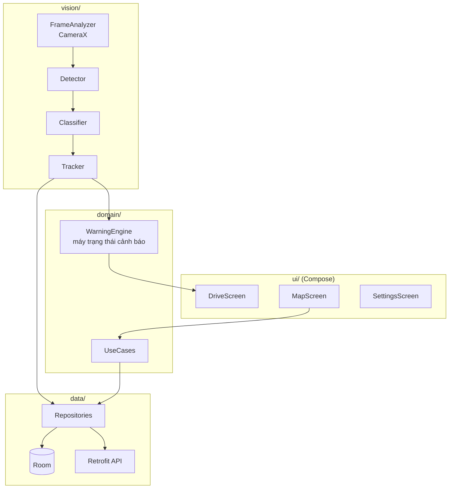

# Signa — Ứng dụng di động

Ứng dụng Android cho người lái: nhận diện biển báo ngay trên điện thoại, cảnh báo bằng giọng nói, xem bản đồ biển báo và dẫn đường.

> **Trạng thái:** chưa có mã nguồn. Tài liệu này là đặc tả phạm vi và quy ước trước khi code.

## Mục lục

- [Phạm vi](#phạm-vi)
- [Công nghệ](#công-nghệ)
- [Kiến trúc trong ứng dụng](#kiến-trúc-trong-ứng-dụng)
- [Cấu trúc thư mục dự kiến](#cấu-trúc-thư-mục-dự-kiến)
- [Màn hình](#màn-hình)
- [Yêu cầu hiệu năng](#yêu-cầu-hiệu-năng)
- [Cài đặt và chạy](#cài-đặt-và-chạy)
- [Cấu hình](#cấu-hình)
- [Kiểm thử](#kiểm-thử)
- [Tài liệu liên quan](#tài-liệu-liên-quan)

## Phạm vi

| Trong phạm vi | Ngoài phạm vi |
| --- | --- |
| Nhận diện biển báo trên thiết bị (TFLite) theo luồng camera | Huấn luyện mô hình (thuộc [`ai/`](../ai/)) |
| Theo dõi biển qua nhiều khung, bỏ phiếu nhãn | iOS |
| Cảnh báo giọng nói (vượt tốc độ, biển cấm sắp tới) | Điều khiển phương tiện |
| Bản đồ biển báo, tải trước theo tuyến, dẫn đường | Chế độ xe máy |
| Gửi quan sát (kết quả + ảnh cắt) lên server khi có mạng | Gửi toàn bộ khung hình |
| Nhận và thay mô hình mới qua mạng | |

## Công nghệ

| Hạng mục | Lựa chọn |
| --- | --- |
| Ngôn ngữ | Kotlin |
| Giao diện | Jetpack Compose, Material 3 |
| Camera | CameraX (`ImageAnalysis`) |
| Suy luận AI | TensorFlow Lite (GPU delegate, dự phòng CPU qua XNNPACK) |
| Bản đồ | VietMap SDK |
| Mạng | Retrofit + OkHttp, Kotlinx Serialization |
| Lưu trữ cục bộ | Room (biển báo tải trước, hàng đợi gửi), DataStore (cài đặt) |
| Kiến trúc | MVVM + Clean Architecture, Hilt (DI), Coroutines/Flow |
| Đọc cảnh báo | Android TextToSpeech (tiếng Việt) |
| Định vị | Fused Location Provider |
| SDK | `minSdk 26`, `targetSdk` mới nhất tại thời điểm khởi tạo |

Lý do chọn nhận diện trên thiết bị: [ADR-0002](../docs/adr/0002-nhan-dien-tren-thiet-bi.md).

## Kiến trúc trong ứng dụng



Luồng xử lý một khung hình nằm trọn trong `vision/`, chạy trên luồng nền; UI chỉ nhận `StateFlow` kết quả.

## Cấu trúc thư mục dự kiến

```text
mobile/
├── app/
│   └── src/
│       ├── main/
│       │   ├── java/com/signa/app/
│       │   │   ├── ui/            # Compose: drive, map, sign, settings, auth
│       │   │   ├── domain/        # model, usecase, warning (máy trạng thái)
│       │   │   ├── data/          # repository, local (Room), remote (Retrofit)
│       │   │   ├── vision/        # analyzer, detector, classifier, tracker, geo
│       │   │   └── di/            # Hilt modules
│       │   ├── assets/models/     # mô hình .tflite nhúng sẵn (không commit)
│       │   └── res/
│       ├── test/                  # unit test (JVM)
│       └── androidTest/           # instrumented + Compose UI test
├── gradle/libs.versions.toml      # version catalog
├── build.gradle.kts
└── settings.gradle.kts
```

## Màn hình

| Màn hình | Chức năng chính | Yêu cầu |
| --- | --- | --- |
| Lái xe | Camera + khung biển nhận diện, tốc độ hiện tại, giới hạn hiện hành, cảnh báo | FR-01 → FR-05 |
| Bản đồ | Biển báo quanh vị trí, lọc theo nhóm/điểm tin cậy, chi tiết biển | FR-06 → FR-08 |
| Dẫn đường | Tìm địa chỉ, chỉ đường, bật nhận diện tự động khi dẫn đường | FR-09 |
| Tra cứu biển | Chụp ảnh → mã biển, ý nghĩa theo QCVN 41 | FR-10 |
| Đóng góp của tôi | Thống kê quan sát đã gửi, trạng thái | FR-11 |
| Tài khoản / Cài đặt | Đăng nhập, loại xe, bật/tắt giọng nói, chỉ gửi qua Wi-Fi | FR-12, FR-13 |

Mã yêu cầu tham chiếu [Đặc tả yêu cầu](../docs/02-dac-ta-yeu-cau.md).

## Yêu cầu hiệu năng

| Chỉ số | Mục tiêu | Cách đo |
| --- | --- | --- |
| Tốc độ xử lý | ≥ 15 FPS trên máy Android tầm trung | Log thời gian mỗi khung, trung bình 5 phút |
| Độ trễ cảnh báo | < 500 ms từ khi biển ổn định đến khi phát âm | Đo bằng video thực địa |
| Pin | < 15 %/giờ khi chạy liên tục | Android Battery Historian |
| Dữ liệu di động | < 20 MB/giờ | Thống kê mạng của ứng dụng |
| Kích thước mô hình | < 15 MB | Kích thước file `.tflite` |

## Cài đặt và chạy

> Hướng dẫn chi tiết được bổ sung khi khởi tạo mã nguồn.

Yêu cầu: Android Studio bản ổn định mới nhất, JDK 17, thiết bị thật Android 8.0+ (emulator không đủ để đo hiệu năng camera).

```bash
cd mobile
cp local.properties.example local.properties   # điền VIETMAP_API_KEY, API_BASE_URL
./gradlew assembleDebug
./gradlew installDebug
```

## Cấu hình

| Khoá (`local.properties`) | Ý nghĩa |
| --- | --- |
| `VIETMAP_API_KEY` | Khoá VietMap SDK |
| `API_BASE_URL` | Địa chỉ nginx của backend: `http://10.0.2.2:8080` trên emulator, `http://<IP máy tính>:8080` trên điện thoại thật cùng mạng |
| `MODEL_VERSION` | Phiên bản bộ mô hình nhúng sẵn; task Gradle `fetchModels` tải bộ này vào `assets/models/` trước khi build |

## Kiểm thử

| Loại | Phạm vi | Lệnh |
| --- | --- | --- |
| Unit | `WarningEngine`, `Tracker`, ánh xạ nhãn | `./gradlew test` |
| Instrumented | Chạy mô hình trên ảnh mẫu, Room | `./gradlew connectedAndroidTest` |
| Thực địa | Video gắn trên xe, đo FPS / cảnh báo sai | Xem [kế hoạch kiểm thử](../docs/08-kiem-thu.md) |

## Tài liệu liên quan

- [Thiết kế AI — chuỗi xử lý trên thiết bị](../docs/04-thiet-ke-ai.md)
- [Đặc tả API](../docs/07-api.md)
- [ADR-0002: Nhận diện trên thiết bị](../docs/adr/0002-nhan-dien-tren-thiet-bi.md)
