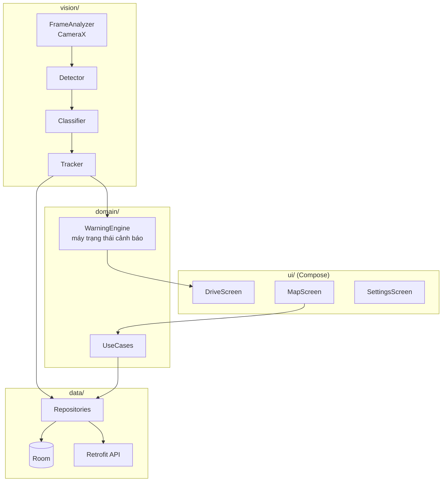

# Signa — Ứng dụng di động

Ứng dụng Android cho người lái: nhận diện biển báo ngay trên điện thoại, cảnh báo bằng giọng nói, xem bản đồ biển báo và dẫn đường.

> **Trạng thái tuần 2:** khung MVVM + Hilt + Flow; điều hướng, DataStore, Room, Retrofit/OkHttp và đầy đủ tài khoản giả lập có lưu/khôi phục/hết hạn phiên. API client đã kiểm thử bằng MockWebServer; chưa nối backend thật. Xem [ARCHITECTURE.md](ARCHITECTURE.md) để biết cấu trúc hiện tại, cách thử tài khoản và giới hạn nghiệm thu.

Kết quả build và kiểm thử: [Nghiệm thu tuần 2](WEEK2_ACCEPTANCE.md).

## Tiến độ giao diện

- Có theme sáng/tối, kiểu chữ và hình dạng dùng chung trong `ui/theme/`.
- Có nút chính, thẻ thông tin, nhãn trạng thái và biểu tượng giới hạn tốc độ trong `ui/components/`.
- `MainActivity` mở `ui/navigation/SignaApp.kt`: Navigation Compose điều hướng năm tab Bản đồ, Lái xe, Tra cứu, Cài đặt và Tài khoản. Mở app chưa có phiên vào khung Đăng nhập/Đăng ký riêng, không có bottom bar. Sau đăng nhập hoặc chủ động chọn khách, khung chính mở ở Bản đồ và có lưu/khôi phục trạng thái tab. Đăng xuất/hết hạn quay về khung xác thực.
- Các tính năng dữ liệu đi theo `Route → Screen/ViewModel → repository`, thu thập StateFlow theo lifecycle. Chi tiết biển dùng ID ổn định; dữ liệu mẫu tập trung tại `data/fake`.
- Đăng ký, đăng nhập, đăng xuất, OTP, đặt lại và đổi mật khẩu chạy bằng fake auth cục bộ. Cần đăng ký trước; mã OTP thử nghiệm hiển thị trên màn hình. Room lưu tài khoản đã băm mật khẩu và phiên được mã hóa bằng Android Keystore, có khôi phục/hết hạn.
- Room lưu cache biển mẫu; API client có DTO, Bearer, timeout và xử lý lỗi HTTP. Có thể chọn RemoteAuthRepository qua cấu hình build.
- Cài đặt lưu bốn lựa chọn bằng DataStore, có trạng thái tải, lỗi lưu trữ và thử lại.
- Giao diện áp dụng bản thiết kế xanh/trắng: bản đồ phủ màn hình có thẻ biển nổi, bảng tốc độ nằm ngang, cài đặt theo nhóm và form tài khoản gọn. Có phiên lái xe, hồ sơ và đóng góp để xem trước; dữ liệu mẫu được ghi rõ.
- Camera, tốc độ và cảnh báo lái xe vẫn ở mức khung. Bản đồ đã dùng VietMap SDK với marker GeoJSON và nút định vị GPS; chưa có key nên chưa tải được bản đồ nền thật. Chưa nối backend biển theo vùng, AI hoặc gửi quan sát. Xem [thiết lập bản đồ](MAP_SETUP.md).
- Các màn xác thực, Tài khoản và Đóng góp đã áp dụng bố cục ảnh mẫu: icon ô nhập, OTP 6 ô/gửi lại, hồ sơ có loại xe và các hàng chức năng dạng thẻ. Giữ nút “Tiếp tục với khách”.
- Xem thử bằng cách chạy cấu hình `app` trên thiết bị. `SignaApp` có Preview sáng/tối; `DriveScreen` có thêm Preview cỡ chữ lớn.

## Mục lục

- [Phạm vi](#phạm-vi)
- [Công nghệ](#công-nghệ)
- [Kiến trúc trong ứng dụng](#kiến-trúc-trong-ứng-dụng)
- [Cấu trúc thư mục dự kiến](#cấu-trúc-thư-mục-dự-kiến)
- [Màn hình](#màn-hình)
- [Yêu cầu hiệu năng](#yêu-cầu-hiệu-năng)
- [Cài đặt và chạy](#cài-đặt-và-chạy)
- [Cấu hình](#cấu-hình)
- [Kiểm thử](#kiểm-thử)
- [Tài liệu liên quan](#tài-liệu-liên-quan)

## Phạm vi

| Trong phạm vi | Ngoài phạm vi |
| --- | --- |
| Nhận diện biển báo trên thiết bị (TFLite) theo luồng camera | Huấn luyện mô hình (thuộc [`ai/`](../ai/)) |
| Theo dõi biển qua nhiều khung, bỏ phiếu nhãn | iOS |
| Cảnh báo giọng nói (vượt tốc độ, biển cấm sắp tới) | Điều khiển phương tiện |
| Bản đồ biển báo, tải trước theo tuyến, dẫn đường | Chế độ xe máy |
| Gửi quan sát (kết quả + ảnh cắt) lên server khi có mạng | Gửi toàn bộ khung hình |
| Nhận và thay mô hình mới qua mạng | |

## Công nghệ

| Hạng mục | Lựa chọn |
| --- | --- |
| Ngôn ngữ | Kotlin |
| Giao diện | Jetpack Compose, Material 3 |
| Camera | CameraX (`ImageAnalysis`) |
| Suy luận AI | TensorFlow Lite (GPU delegate, dự phòng CPU qua XNNPACK) |
| Bản đồ | VietMap SDK |
| Mạng | Retrofit + OkHttp, Kotlinx Serialization |
| Lưu trữ cục bộ | Room (biển báo tải trước, hàng đợi gửi), DataStore (cài đặt) |
| Kiến trúc | MVVM + Clean Architecture, Hilt (DI), Coroutines/Flow |
| Đọc cảnh báo | Android TextToSpeech (tiếng Việt) |
| Định vị | Fused Location Provider |
| SDK | `minSdk 26`, `targetSdk` mới nhất tại thời điểm khởi tạo |

Lý do chọn nhận diện trên thiết bị: [ADR-0002](../docs/adr/0002-nhan-dien-tren-thiet-bi.md).

## Kiến trúc trong ứng dụng



Luồng xử lý một khung hình nằm trọn trong `vision/`, chạy trên luồng nền; UI chỉ nhận `StateFlow` kết quả.

## Cấu trúc thư mục dự kiến

```text
mobile/
├── app/
│   └── src/
│       ├── main/
│       │   ├── java/com/signa/app/
│       │   │   ├── ui/            # Compose: drive, map, sign, settings, auth
│       │   │   ├── domain/        # model, usecase, warning (máy trạng thái)
│       │   │   ├── data/          # repository, local (Room), remote (Retrofit)
│       │   │   ├── vision/        # analyzer, detector, classifier, tracker, geo
│       │   │   └── di/            # Hilt modules
│       │   ├── assets/models/     # mô hình .tflite nhúng sẵn (không commit)
│       │   └── res/
│       ├── test/                  # unit test (JVM)
│       └── androidTest/           # instrumented + Compose UI test
├── gradle/libs.versions.toml      # version catalog
├── build.gradle.kts
└── settings.gradle.kts
```

## Màn hình

| Màn hình | Chức năng chính | Yêu cầu |
| --- | --- | --- |
| Lái xe | Camera + khung biển nhận diện, tốc độ hiện tại, giới hạn hiện hành, cảnh báo | FR-01 → FR-05 |
| Bản đồ | Biển báo quanh vị trí, lọc theo nhóm/điểm tin cậy, chi tiết biển | FR-06 → FR-08 |
| Dẫn đường | Tìm địa chỉ, chỉ đường, bật nhận diện tự động khi dẫn đường | FR-09 |
| Tra cứu biển | Chụp ảnh → mã biển, ý nghĩa theo QCVN 41 | FR-10 |
| Đóng góp của tôi | Thống kê quan sát đã gửi, trạng thái | FR-11 |
| Tài khoản / Cài đặt | Đăng nhập, loại xe, bật/tắt giọng nói, chỉ gửi qua Wi-Fi | FR-12, FR-13 |

Mã yêu cầu tham chiếu [Đặc tả yêu cầu](../docs/02-dac-ta-yeu-cau.md).

## Yêu cầu hiệu năng

| Chỉ số | Mục tiêu | Cách đo |
| --- | --- | --- |
| Tốc độ xử lý | ≥ 15 FPS trên máy Android tầm trung | Log thời gian mỗi khung, trung bình 5 phút |
| Độ trễ cảnh báo | < 500 ms từ khi biển ổn định đến khi phát âm | Đo bằng video thực địa |
| Pin | < 15 %/giờ khi chạy liên tục | Android Battery Historian |
| Dữ liệu di động | < 20 MB/giờ | Thống kê mạng của ứng dụng |
| Kích thước mô hình | < 15 MB | Kích thước file `.tflite` |

## Cài đặt và chạy

Yêu cầu theo toolchain hiện tại: Android SDK 37, Oracle JDK 25 đầy đủ (có `jlink`), thiết bị Android 8.0+ hoặc emulator. Gradle daemon được ghim JDK 25 trong `gradle/gradle-daemon-jvm.properties`; không dùng JRE đi kèm extension Java của VS Code. Camera/hiệu năng cần đo trên máy thật ở giai đoạn sau.

```bash
cd mobile
./gradlew assembleDebug
./gradlew installDebug
```

## Cấu hình

| Khoá (`local.properties`) | Ý nghĩa |
| --- | --- |
| `VIETMAP_API_KEY` | Key VietMap đọc từ file này hoặc biến môi trường cùng tên; cần build lại sau khi thêm key |
| `VIETMAP_SEARCH_API_KEY` | Key Autocomplete/Place; mặc định dùng key bản đồ khi bỏ trống |
| `VIETMAP_ROUTE_API_KEY` | Key Route tùy chọn; mặc định dùng key search |
| `API_BASE_URL` | Địa chỉ nginx của backend: `http://10.0.2.2:8080` trên emulator, `http://<IP máy tính>:8080` trên điện thoại thật cùng mạng |
| `MODEL_VERSION` | Dự kiến dùng khi tích hợp mô hình; hiện chưa có task `fetchModels` |

Mặc định dùng fake auth. Chọn backend thật bằng `-Psigna.useFakeBackend=false`; URL có thể truyền qua `-Psigna.apiBaseUrl` hoặc `SIGNA_API_BASE_URL`. Chi tiết request/response và phần cần đối chiếu backend nằm trong [ARCHITECTURE.md](ARCHITECTURE.md).

## Kiểm thử

| Loại | Phạm vi | Lệnh |
| --- | --- | --- |
| Unit hiện có | Form/ViewModel, phiên, băm mật khẩu, Retrofit/OkHttp qua MockWebServer | `./gradlew :app:testDebugUnitTest` |
| Instrumented hiện có | Room, Keystore, tài khoản/OTP, cache, DataStore | `./gradlew :app:connectedDebugAndroidTest` |
| Build/lint | APK debug và kiểm tra Android | `./gradlew :app:assembleDebug :app:lintDebug` |
| Thực địa | Video gắn trên xe, đo FPS / cảnh báo sai | Xem [kế hoạch kiểm thử](../docs/08-kiem-thu.md) |

## Tài liệu liên quan

- [Thiết kế AI — chuỗi xử lý trên thiết bị](../docs/04-thiet-ke-ai.md)
- [Đặc tả API](../docs/07-api.md)
- [ADR-0002: Nhận diện trên thiết bị](../docs/adr/0002-nhan-dien-tren-thiet-bi.md)

## Bản đồ hiện tại

Đã có tìm địa chỉ, chọn điểm đến, xem trước tuyến đường, khoảng cách và thời gian dự kiến bằng API VietMap thật, dùng được trong chế độ khách. `DirectionsViewModel` quản lý tác vụ tìm kiếm/chỉ đường; `MapViewModel` quản lý biển cache và định vị; repository và client HTTP nằm trong data. Cấu hình, kiểm chứng và giới hạn hiện tại xem [MAP_SETUP.md](MAP_SETUP.md).

## Camera hiện tại

Màn Lái xe có camera sau CameraX thật, xin quyền khi bắt đầu, tạm dừng/bật lại và nhả tài nguyên khi xuống nền hoặc kết thúc. Điều khiển thiết bị nằm trong `vision/camera/`; chưa có nhận diện AI hoặc tốc độ GPS trong màn Lái xe. Xem [CAMERA_SETUP.md](CAMERA_SETUP.md).
